# 4.6. Domain-Driven Software Architecture

## 4.6.1. Design-Level Event Storming

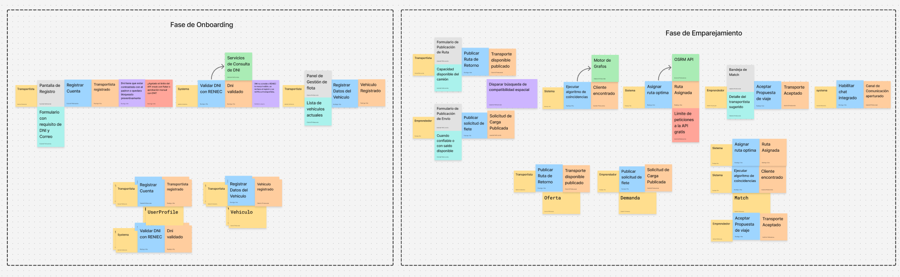

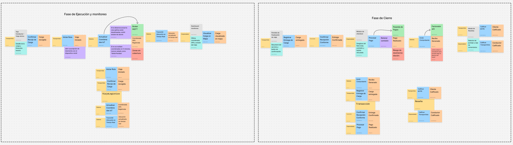

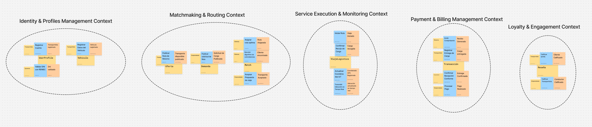

> *Fuente: Elaboración propia. Ver **Anexo F – Event Storming Completo** para el tablero interactivo completo en Figma.*

A continuación se detallan las entidades principales de Trazza, organizadas por Bounded Context, distinguiendo cuáles actúan como Raíz de Agregado (Aggregate Root) y cuáles son entidades hijas o Value Objects asociados:

### 1. Contexto: IAM & Perfiles (Identity & Profile Management)
- **User / Usuario (Aggregate Root):** Gestiona las credenciales de acceso (`email`, `passwordHash`, `phone`), el estado de la cuenta, los roles habilitados (`CARRIER`, `MERCHANT`, `ADMIN`) y la rotación de sesiones mediante `RefreshToken`.
- **PersonIdentity & IdentityVerification (Entidades):** Almacenan la identidad personal cifrada con AES-GCM (DNI/CE) y los registros de verificación de identidad ante el proveedor simulado RENIEC.
- **CarrierProfile / PerfilTransportista (Aggregate Root):** Representa el perfil operativo del transportista independiente o empresa de transporte y resguarda las invariantes de su flota.
- **Vehicle / Vehiculo y Driver / Conductor (Aggregate Roots de Flota):** Registran los camiones disponibles (placa única, dimensiones, capacidad máxima en kg/m³ y soporte IoT) y los conductores habilitados con su licencia de conducir.
- **MerchantProfile / PerfilEmprendedor y SavedAddress (Aggregate Roots):** Almacenan los datos comerciales del emprendedor (razón social, RUC de 11 dígitos, rubro) y sus direcciones frecuentes de recojo y entrega con coordenadas geográficas.

### 2. Contexto: Matchmaking & Routing (Core Domain)
- **ReturnRoute / RutaRetorno (Aggregate Root):** Representa el viaje de retorno publicado por un transportista con origen, destino, radio de corredor (`Detour`), ventana horaria (`TimeWindow`) y capacidad libre disponible (`Cargo`).
- **ShipmentRequest / SolicitudEnvio (Aggregate Root):** Define la necesidad de transporte publicada por un emprendedor (peso, volumen, valor declarado, tipo de carga, puntos de recojo/entrega y tarifa referencial), evaluada por el servicio de dominio `RouteMatchingService`.
- **MatchProposal / PropuestaMatch y Message (Aggregate Roots):** Gestionan la propuesta de emparejamiento entre una `ReturnRoute` y un `ShipmentRequest`, sus transiciones de estado (`pending`, `accepted`, `rejected`, `cancelled`, `expired`) y el hilo de mensajes de negociación previo a la creación automática del viaje.

### 3. Contexto: Service Execution & Monitoring (IoT & Tránsito)
- **Trip / ViajeLogistico (Aggregate Root):** Controla el ciclo de vida del servicio desde la aceptación de la propuesta hasta la confirmación de recepción por el emprendedor (`scheduled`, `in_transit`, `delivered`, `confirmed`, `cancelled`), incluyendo la asignación de conductor y dispositivo IoT (`IotDevice`).
- **TrackingPoint y DeviationAlert (Entidades dentro del agregado Trip):** Registran la telemetría GPS en tiempo real (`GeoLocation`) y emiten alertas automáticas cuando el vehículo supera el umbral de desvío permitido respecto al corredor de la ruta planificada.
- **Incident / Incidencia (Aggregate Root):** Registra cualquier eventualidad operativa o daño en la mercadería reportado durante el viaje o hasta 48 horas después de la entrega, junto con sus evidencias adjuntas y estado de resolución.

### 4. Contexto: Payment & Billing (Pagos)
- **Plan y Subscription (Aggregate Roots):** Administran el catálogo de planes de monitoreo para transportistas (límites de vehículos y cobertura) y el ciclo de suscripción activa con pagos simulados (`SubscriptionPayment`), renovación y cancelación.
- **FreightSettlement / LiquidacionFlete (Aggregate Root):** Registra el acuerdo económico del flete por cada viaje completado, permitiendo que el emprendedor marque el pago realizado y el transportista confirme la recepción del abono.
- **CancellationCompensation / CompensacionCancelacion (Aggregate Root):** Gestiona la compensación por lucro cesante generada cuando una de las partes cancela un viaje después de haberse comprometido operativamente.

### 5. Contexto: Loyalty & Reputation (Calificaciones)
- **Rating / Calificacion (Aggregate Root):** Registra la evaluación mutua (puntuación de 1 a 5 estrellas y comentario) emitida por el transportista y el emprendedor al finalizar un viaje confirmado, alimentando el resumen de reputación (`ReputationSummary`) de cada usuario.
- **LoyaltyPointEntry / PuntosFidelidad (Aggregate Root):** Administra el libro mayor de puntos de fidelidad acumulados por viajes completados y calificaciones otorgadas, así como su canje por beneficios dentro de la plataforma.

## 4.6.2. Software Architecture Context Diagram

A continuación se presenta el **Context Diagram** (Nivel 1), el cual ilustra de manera global la interacción de Trazza Platform con sus actores y sistemas externos.

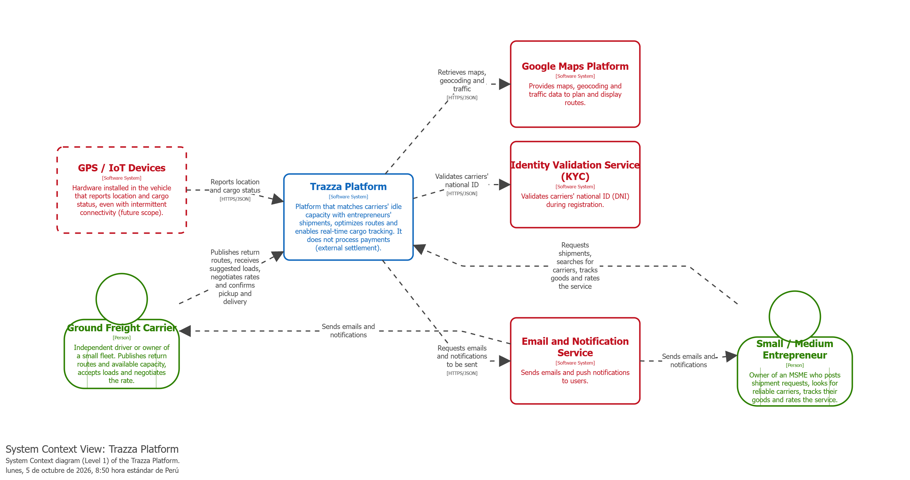

**Diagram key**
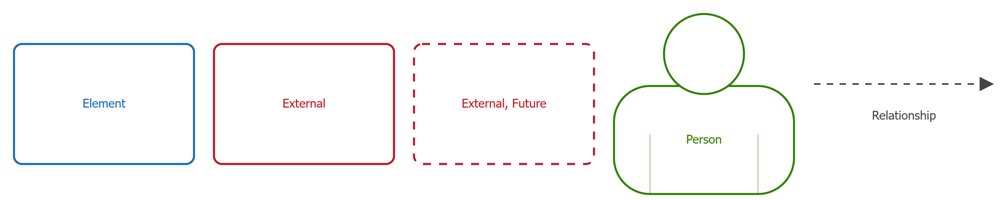

## 4.6.3. Software Architecture Container Diagrams

Haciendo un acercamiento, el **Container diagram** (Nivel 2) detalla las aplicaciones principales que conforman el sistema y cómo se comunican entre sí.

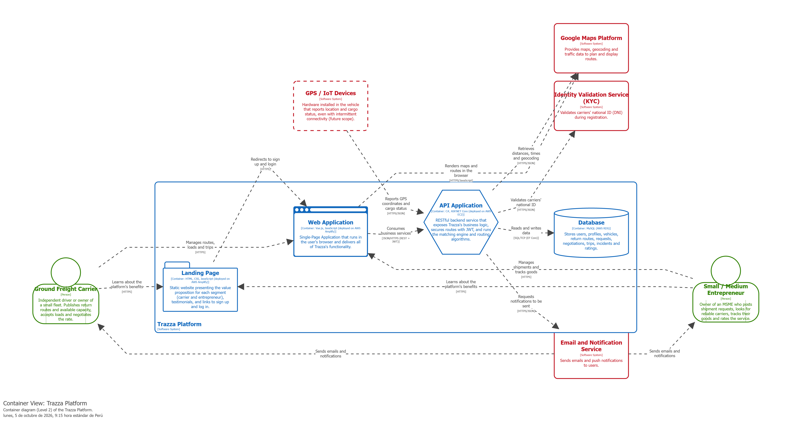

**Diagram key**
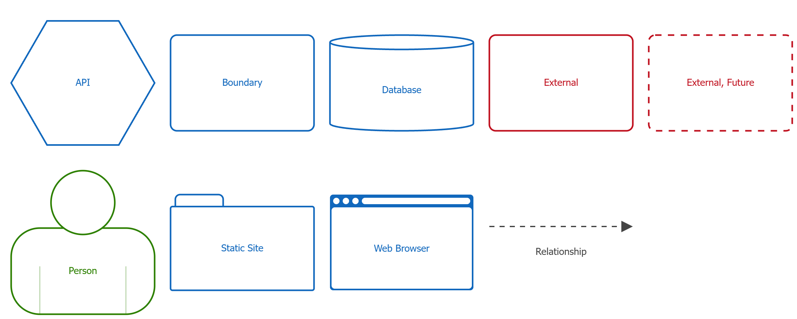
## 4.6.4. Software Architecture Components Diagrams

A continuación se detalla la arquitectura interna de los dos contenedores principales de la plataforma Trazza, ilustrando cómo las responsabilidades se distribuyen a nivel de código fuente.

### 4.6.4.1. Frontend Web Application Components

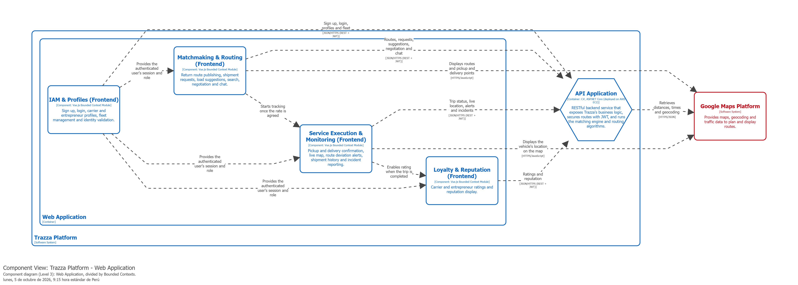

**Diagram key**
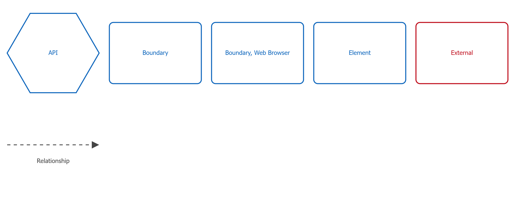
### 4.6.4.2. API Application Components (Matchmaking Core)

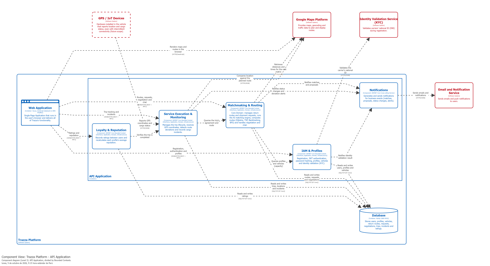

**Diagram key**
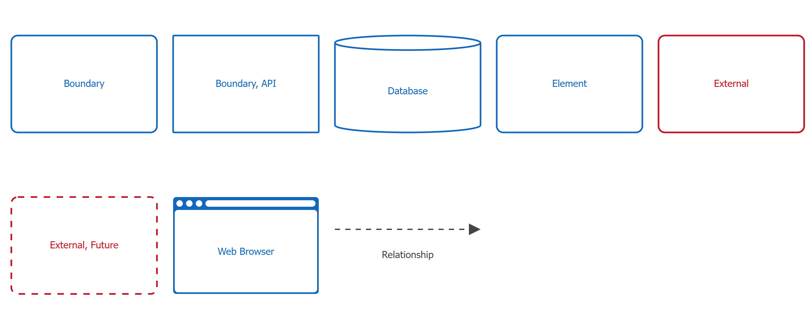

