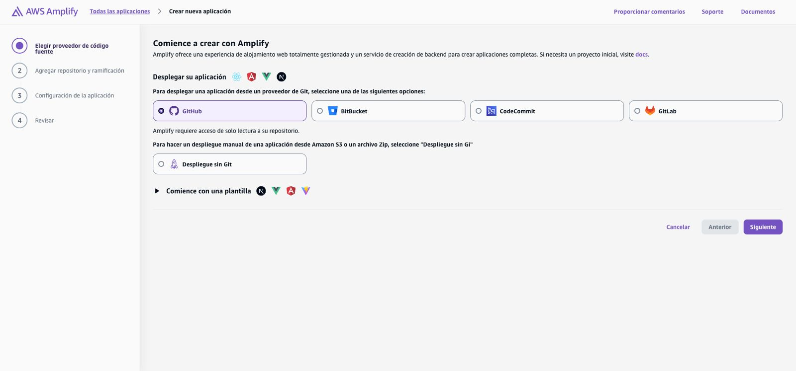
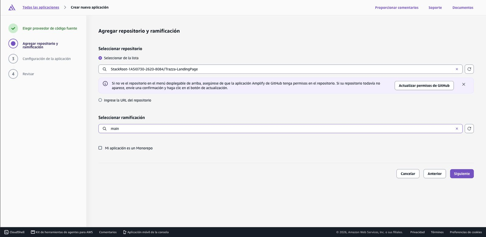
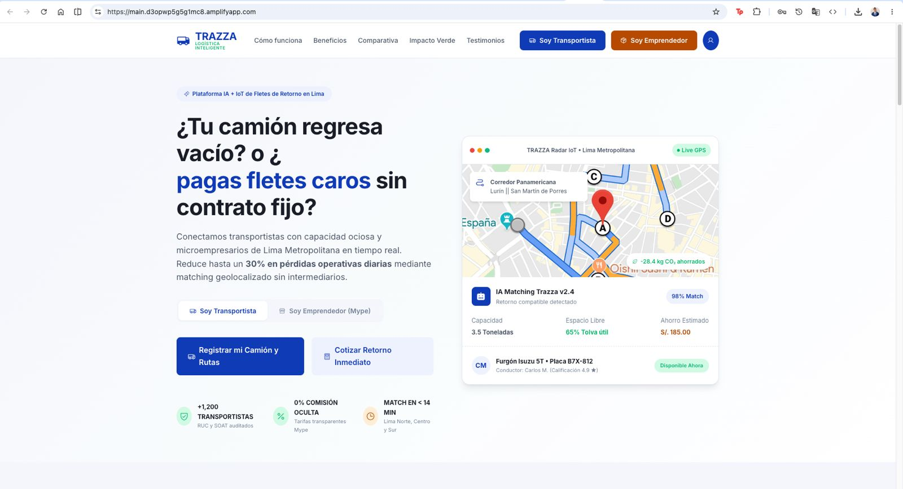
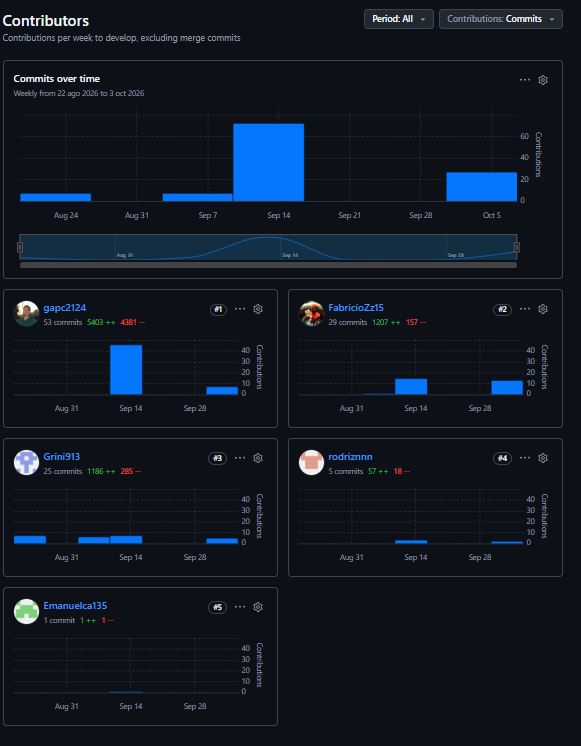
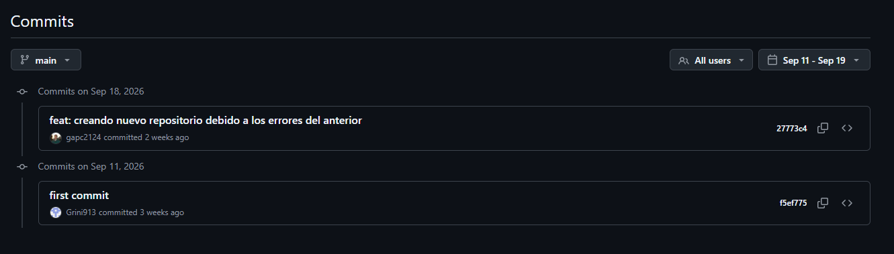

## 5.2. Landing Page, Services & Applications Implementation
 
En esta sección se explica y evidencia el proceso de implementación, pruebas, documentación y despliegue del Landing Page, los Web Services y la Frontend Web Application de Trazza, organizado por Sprint. En el Sprint 1 el equipo implementó y desplegó la primera versión del Landing Page. En el Sprint 2 se publicó una nueva versión del Landing Page y la primera versión de la Web Application, construida a partir de los diseños de la sección 4.4 sobre una API simulada. En el Sprint 3 se implementaron y desplegaron los Web Services en ASP.NET Core y se integró la Web Application con ellos.
 
### 5.2.1. Sprint 1
 
En esta sección se registra el avance en producto y en trabajo colaborativo del Sprint 1, cuyo alcance fue la primera versión del Landing Page, primer punto de contacto de Trazza con transportistas y comerciantes MYPE.
 
#### 5.2.1.1. Sprint Planning 1
 
En el Sprint Planning 1 el equipo definió el objetivo del Sprint y seleccionó las User Stories del Landing Page con mayor prioridad en el Product Backlog.
 
| Sprint # | Sprint 1 |
| :--- | :--- |
| **Sprint Planning Background** | |
| Date | 2026-09-18 |
| Time | 10:00 AM |
| Location | Reunión virtual vía Microsoft Teams |
| Prepared By | Peñaranda Caldas, Gabriel Augusto |
| Attendees (to planning meeting) | Checalla Apaza, Emanuel Renato / Lozano Quispe, Fabricio Jofred / Medina Merma, Ingrid Melani / Peñaranda Caldas, Gabriel Augusto / Vite Celis, Rodrigo Matias |
| Sprint 0 Review Summary | N/A. Es el primer Sprint del proyecto. |
| Sprint 0 Retrospective Summary | N/A. Es el primer Sprint del proyecto. |
| **Sprint Goal & User Stories** | |
| Sprint 1 Goal | **Nuestro enfoque está en** publicar la primera versión del Landing Page de Trazza, que presente la propuesta de valor para transportistas con viajes de retorno vacíos y para comerciantes MYPE que necesitan enviar mercadería por Lima. **Creemos que esto entrega** una primera razón clara para registrarse **a** transportistas independientes y comerciantes MYPE de Lima. **Esto se confirmará cuando** un visitante pueda abrir el Landing Page desde una URL pública, identificar la propuesta para su segmento, leer los testimonios y llegar al formulario de registro de su rol. |
| Sprint 1 Velocity | 5 Story Points |
| Sum of Story Points | 5 Story Points (US04: 2, US05: 2, US25: 1) |
 
#### 5.2.1.2. Aspect Leaders and Collaborators
 
Los aspectos del Sprint 1 son la implementación del Landing Page, el diseño de sus wireframes y mock-ups (sección 4.3) y su despliegue. Los líderes se asignaron según la participación registrada en los repositorios.
 
| Team Member (Last Name, First Name) | GitHub Username | Landing Page Implementation (L/C) | Landing Page UI Design (L/C) | Landing Page Deployment (L/C) |
| :--- | :--- | :---: | :---: | :---: |
| Checalla Apaza, Emanuel Renato | Emanuelca135 | C | C | L |
| Lozano Quispe, Fabricio Jofred | FabricioZz15 | C | L | C |
| Medina Merma, Ingrid Melani | Grini913 | C | C | C |
| Peñaranda Caldas, Gabriel Augusto | gapc2124 | L | C | C |
| Vite Celis, Rodrigo Matias | rodriznnn | C | C | C |
 
#### 5.2.1.3. Sprint Backlog 1
 
El objetivo del Sprint 1 fue publicar la primera versión del Landing Page. Las User Stories se descompusieron en tareas de 4 a 8 horas.
 
 
**URL público del Board:** [https://trazza.youtrack.cloud/agiles/204-1/current](https://trazza.youtrack.cloud/agiles/204-1/current)
 
| Sprint # | Sprint 1 | | | | | | |
| :--- | :--- | :--- | :--- | :--- | :--- | :--- | :--- |
| **User Story** | | **Work-Item / Task** | | | | | |
| **Id** | **Title** | **Id** | **Title** | **Description** | **Estimation (Hours)** | **Assigned To** | **Status** |
| US04 | Landing Page: Propuesta para Transportistas | T01 | Estructura base del repositorio | Crear el repositorio `Trazza-LandingPage` y la estructura inicial del sitio. | 4 | Medina Merma, Ingrid Melani | Done |
| US04 | Landing Page: Propuesta para Transportistas | T02 | Header, navegación y Hero | Implementar la barra de navegación responsive y la sección Hero con los botones por rol. | 6 | Peñaranda Caldas, Gabriel Augusto | Done |
| US04 | Landing Page: Propuesta para Transportistas | T03 | Sección para transportistas | Maquetar los beneficios para el transportista y el llamado a registrarse. | 4 | Peñaranda Caldas, Gabriel Augusto | Done |
| US05 | Landing Page: Propuesta para Emprendedores | T04 | Sección para comerciantes y comparativa | Maquetar los beneficios para el comerciante MYPE y la comparativa frente al flete tradicional. | 5 | Peñaranda Caldas, Gabriel Augusto | Done |
| US25 | Landing Page: Testimonios de Éxito | T05 | Testimonios y footer | Implementar las tarjetas de testimonios, la sección de contacto y el footer. | 4 | Peñaranda Caldas, Gabriel Augusto | Done |
| — | Constraint: despliegue | T06 | Despliegue en AWS Amplify | Conectar el repositorio con AWS Amplify, publicar la rama `main` y validar la URL pública. | 4 | Checalla Apaza, Emanuel Renato | Done |
 
#### 5.2.1.4. Development Evidence for Sprint Review
 
En el Sprint 1 se creó el repositorio del Landing Page y se implementó su primera versión, que luego se publicó en AWS Amplify. En paralelo se documentaron en el informe el diseño del Landing Page y la configuración del proyecto. La siguiente tabla muestra los commits relacionados con la implementación.
 
| Repository | Branch | Commit Id | Commit Message | Commit Message Body | Committed on (Date) |
| :--- | :--- | :--- | :--- | :--- | :--- |
| StackRoot-1ASI0730-2620-8084/Trazza-LandingPage | main | f5ef775 | first commit | - | 2026-09-11 |
| StackRoot-1ASI0730-2620-8084/Trazza-LandingPage | main | 27773c4 | feat: creando nuevo repositorio debido a los errores del anterior | - | 2026-09-18 |
| StackRoot-1ASI0730-2620-8084/Trazza-report | feature/43-landing-page-ui-design | 11323a7 | docs(landing): add landing wireframes images | - | 2026-09-18 |
| StackRoot-1ASI0730-2620-8084/Trazza-report | feature/43-landing-page-ui-design | be862b6 | docs(landing): add landing mock ups desk images | - | 2026-09-18 |
| StackRoot-1ASI0730-2620-8084/Trazza-report | feature/43-landing-page-ui-design | a05df02 | docs(chapter4): add landing page ui design desktop wireframes and mockups descriptions | - | 2026-09-18 |
| StackRoot-1ASI0730-2620-8084/Trazza-report | feature/51-software-configuration-management | 78675b9 | doc(5.1): add complete content for software configuration management | - | 2026-09-18 |
| StackRoot-1ASI0730-2620-8084/Trazza-report | feature/52-landing-page-services-applications-implementation | 84eb2d8 | doc(5.2): populate sprint 1 implementation and evidence sections | - | 2026-09-18 |
 
#### 5.2.1.5. Execution Evidence for Sprint Review
 
Al cierre del Sprint 1, el Landing Page quedó publicado en una URL pública. Presentaba la propuesta de valor para ambos segmentos, la comparativa frente al flete tradicional, los testimonios y los accesos al registro por rol.
 

  
    
  
    
  

**Video de navegación del Sprint 1:** [upc-pre-202620-1asi0730-8084-StackRoot-productnavigation-sprint-1.mp4](https://upcedupe-my.sharepoint.com/:v:/g/personal/u202414356_upc_edu_pe/IQAHwNmBh-BrSIywebxTh1XRAXSQ67CxwXjsw4F17WnJ3nQ?e=dc5eL3&nav=eyJyZWZlcnJhbEluZm8iOnsicmVmZXJyYWxBcHAiOiJTdHJlYW1XZWJBcHAiLCJyZWZlcnJhbFZpZXciOiJTaGFyZURpYWxvZy1MaW5rIiwicmVmZXJyYWxBcHBQbGF0Zm9ybSI6IldlYiIsInJlZmVycmFsTW9kZSI6InZpZXcifX0%3D)
 
#### 5.2.1.6. Services Documentation Evidence for Sprint Review
 
El alcance del Sprint 1 se limitó al Landing Page, que es un sitio estático. Por ello, en este Sprint no se implementaron ni documentaron endpoints con OpenAPI. Los Web Services de Trazza se implementarán en ASP.NET Core en un Sprint posterior.
 
#### 5.2.1.7. Software Deployment Evidence for Sprint Review
 
En el Sprint 1 se creó la aplicación en AWS Amplify Hosting y se conectó con la rama `main` del repositorio `Trazza-LandingPage`, siguiendo los pasos descritos en la sección 5.1.4. Al ser un sitio estático, no requiere comando de build. Desde entonces, cada cambio integrado en `main` se publica automáticamente.
 
**URL del Landing Page:** [https://main.d3opwp5g5g1mc8.amplifyapp.com](https://main.d3opwp5g5g1mc8.amplifyapp.com)
 

  

#### 5.2.1.8. Team Collaboration Insights during Sprint
 
En el Sprint 1 el equipo trabajó en dos repositorios. En `Trazza-LandingPage` se registraron 2 commits: Medina Merma, Ingrid Melani (estructura inicial) y Peñaranda Caldas, Gabriel Augusto (primera versión completa), ambos directamente en `main`. En `Trazza-report` cada sección del informe se trabajó en su rama `feature/*` y se integró a `develop` mediante Pull Requests, con commits de los cinco integrantes.
 
Los gráficos de Contributors muestran las contribuciones semanales de cada integrante. Las barras de las semanas del 7 y 14 de septiembre corresponden al Sprint 1.
 

  
    
  
    
  
    
  

### 5.2.2. Sprint 2

En esta sección se registra el avance en producto y en trabajo colaborativo correspondiente al Sprint 2.

#### 5.2.2.1. Sprint Planning 2

En el Sprint Planning 2 el equipo definió el objetivo del Sprint y seleccionó las User Stories correspondientes de acuerdo con su prioridad dentro del Product Backlog.

| Sprint # | Sprint 2 |
| :--- | :--- |
| **Sprint Planning Background** | |
| Date |05/10/2026 |
| Time | 10:00 p.m |
| Location | Modalidad Remota a través de la plataforma Discord |
| Prepared By |  Peñaranda Caldas, Gabriel Augusto |
| Attendees (to planning meeting) | Checalla Apaza, Emanuel Renato / Lozano Quispe, Fabricio Jofred / Medina Merma, Ingrid Melani / Peñaranda Caldas, Gabriel Augusto / Vite Celis, Rodrigo Matias |
| Sprint 1 Review Summary | En este sprint, el equipo avanzó en la primera versión funcional de Trazza, desarrollando la Landing Page y las funcionalidades iniciales de registro y autenticación. También se establecieron las bases para la integración y despliegue de los componentes del sistema. Como mejora, identificamos la necesidad de seguir refinando la experiencia de usuario y fortalecer la integración entre los diferentes módulos. |
| Sprint 1 Retrospective Summary | Durante este sprint, el equipo mantuvo una colaboración constante mediante la distribución de responsabilidades y el uso de GitHub para integrar los avances. Sin embargo, se identificaron oportunidades de mejora en la coordinación de tareas, comunicación e integración de cambios entre ramas. Para el siguiente sprint, buscaremos mejorar la organización del trabajo y mantener una comunicación más constante entre los integrantes. |
| **Sprint Goal & User Stories** | |
| Sprint 2 Goal | Nuestro enfoque es desplegar la primera versión funcional del frontend de la aplicación web de Trazza. Consideramos que esto permitirá a los usuarios contar con una primera interfaz funcional para interactuar con la plataforma. El objetivo se considerará cumplido cuando el frontend se encuentre desplegado y permita acceder y navegar correctamente por las principales vistas implementadas. |
| Sprint 2 Velocity |30 Story Points. |
| Sum of Story Points | 30 Story Points. |

#### 5.2.2.2. Aspect Leaders and Collaborators

En esta sección se presentan los líderes y colaboradores responsables de los principales aspectos desarrollados durante el Sprint 2.

| Team Member (Last Name, First Name) | GitHub Username | Landing Page Implementation (L/C) | Landing Page UI Design (L/C) | Landing Page Deployment (L/C) |
| :--- | :--- | :---: | :---: | :---: |
| Checalla Apaza, Emanuel Renato | Emanuelca135 | C | C | C |
| Lozano Quispe, Fabricio Jofred | FabricioZz15 | C | L | C |
| Medina Merma, Ingrid Melani | Grini913 | L | C | C |
| Peñaranda Caldas, Gabriel Augusto | gapc2124 | C | C | C |
| Vite Celis, Rodrigo Matias | rodriznnn | C | C | C |

#### 5.2.2.3. Sprint Backlog 2

El objetivo del Sprint 2 fue desplegar la primera versión del frontend de la Web Application. Las tareas se agruparon por bounded context y se trabajaron en el repositorio `trazza-webapp`. En paralelo se publicó una nueva versión del Landing Page en `trazza-website`.

**URL público del Board:** [Pendiente: URL del Board del Sprint 2](URL)

| Sprint # | Sprint 2 | | | | | | |
| :--- | :--- | :--- | :--- | :--- | :--- | :--- | :--- |
| **User Story** | | **Work-Item / Task** | | | | | |
| **Id** | **Title** | **Id** | **Title** | **Description** | **Estimation (Hours)** | **Assigned To** | **Status** |
| US04, US05 | Landing Page: propuesta por segmento | T01 | Traducción y rediseño del Landing Page | Traducir el sitio al inglés, actualizar el diseño y activar el selector de idioma EN / ES. | [Pendiente] | Vite Celis, Rodrigo Matias | Done |
| US04, US05 | Landing Page: propuesta por segmento | T02 | Fotos reales y limpieza de estilos | Reemplazar imágenes de carriers y merchants por fotos reales y depurar el CSS y el i18n. | [Pendiente] | Lozano Quispe, Fabricio Jofred | Done |
| US03 | Inicio de Sesión de Usuario | T03 | Enlace del Landing Page a la Web App | Conectar los botones de inicio de sesión del Landing Page con la Web Application desplegada. | [Pendiente] | Vite Celis, Rodrigo Matias | Done |
| US01, US02, US03 | Registro e inicio de sesión | T04 | Base del frontend e IAM | Crear el proyecto Vue + Vite con shared kernel, layout, router, i18n y las vistas de registro, inicio de sesión, perfil y vehículos. | [Pendiente] | Vite Celis, Rodrigo Matias | Done |
| US08 a US13 | Matchmaking & Routing | T05 | Vistas de rutas, solicitudes y ofertas | Implementar publicación de rutas de retorno, solicitudes de flete, sugerencias de carga, búsqueda de transportistas y ofertas. | [Pendiente] | Vite Celis, Rodrigo Matias | Done |
| US15 a US17, US24 | Service Execution & Monitoring | T06 | Vistas de viaje activo y seguimiento | Implementar viaje activo, seguimiento del envío e historiales de viajes y envíos. | [Pendiente] | Vite Celis, Rodrigo Matias | Done |
| — | Payment & Billing: planes de suscripción | T07 | Bounded context de Billing | Implementar value objects, agregados, API, store, rutas y la vista de planes y facturación. | [Pendiente] | Lozano Quispe, Fabricio Jofred | Done |
| — | Constraint: API simulada | T08 | Fake API con json-server | Exponer los recursos del frontend con `json-server` y apuntar `.env.production` al endpoint publicado. | [Pendiente] | Peñaranda Caldas, Gabriel Augusto | Done |
| — | Constraint: despliegue | T09 | Despliegue del frontend en AWS Amplify | Publicar la rama `main` de `trazza-webapp` en AWS Amplify Hosting. | [Pendiente] | [Pendiente] | Done |

#### 5.2.2.4. Development Evidence for Sprint Review

En el Sprint 2 se creó el repositorio `trazza-webapp` con la primera versión del frontend, se añadió el bounded context de Billing y se publicó una nueva versión del Landing Page. La siguiente tabla muestra los commits principales.

| Repository | Branch | Commit Id | Commit Message | Commit Message Body | Committed on (Date) |
| :--- | :--- | :--- | :--- | :--- | :--- |
| StackRoot-1ASI0730-2620-8084/trazza-website | main | 36e7cb1 | feat: translate landing page from Spanish to English | - | 2026-10-04 |
| StackRoot-1ASI0730-2620-8084/trazza-website | main | a128fa9 | feat: update landing page design | - | 2026-10-05 |
| StackRoot-1ASI0730-2620-8084/trazza-website | main | a5f1c06 | feat: make the EN \| ES language switch translate the site | - | 2026-10-05 |
| StackRoot-1ASI0730-2620-8084/trazza-website | main | bafb49f | feat: add real photos to the carriers and merchants sections | - | 2026-10-05 |
| StackRoot-1ASI0730-2620-8084/trazza-website | main | 7af16ae | docs: update i18n | - | 2026-10-06 |
| StackRoot-1ASI0730-2620-8084/trazza-website | main | 5ba8733 | feat: link sign in buttons to the web app | - | 2026-10-06 |
| StackRoot-1ASI0730-2620-8084/trazza-webapp | main | be8aed3 | Initial commit | - | 2026-10-05 |
| StackRoot-1ASI0730-2620-8084/trazza-webapp | feature/payment-billing | 286a341 | feat(billing): add subscription-plan value object | - | 2026-10-05 |
| StackRoot-1ASI0730-2620-8084/trazza-webapp | feature/payment-billing | 23362b8 | feat(billing): add payment-transaction aggregate | - | 2026-10-05 |
| StackRoot-1ASI0730-2620-8084/trazza-webapp | feature/payment-billing | 53caadd | feat(billing): add billing-api | - | 2026-10-05 |
| StackRoot-1ASI0730-2620-8084/trazza-webapp | feature/payment-billing | a0fd02f | feat(billing): add billing store | - | 2026-10-05 |
| StackRoot-1ASI0730-2620-8084/trazza-webapp | feature/payment-billing | 05c209a | feat(billing): add plan-billing view | - | 2026-10-05 |
| StackRoot-1ASI0730-2620-8084/trazza-webapp | feature/payment-billing | e0167dc | feat(billing): add billing-routes | - | 2026-10-05 |
| StackRoot-1ASI0730-2620-8084/trazza-webapp | main | 0ad54fa | chore: update API URL to EC2 DuckDNS endpoint | - | 2026-10-05 |
| StackRoot-1ASI0730-2620-8084/trazza-report | feature/52-landing-page-services-applications-implementation | fad3731 | docs: add 5.2.1 Sprint 1 to chapter 5 | - | 2026-10-05 |
| StackRoot-1ASI0730-2620-8084/trazza-report | develop | 1fad080 | docs: add part of sprint 2 documentation | - | 2026-10-05 |

#### 5.2.2.5. Execution Evidence for Sprint Review

Al cierre del Sprint 2, la Web Application quedó publicada con sus vistas principales por bounded context. En este Sprint las vistas consumían una API simulada con `json-server`, que se reemplazó por los Web Services reales en el Sprint 3.

| Evidence | Description | Related User Story | Status |
| :--- | :--- | :--- | :--- |
| Registro e inicio de sesión | Vistas `sign-up` y `sign-in` con elección de rol Carrier / Merchant. | US01, US02, US03 | Done |
| Perfil y vehículos | Vistas `profile`, `vehicle-list` y `vehicle-form`. | US23 | Done |
| Rutas de retorno y sugerencias | Vistas `return-route-form`, `return-route-list`, `load-suggestions` y `load-detail`. | US08, US10, US12, US13 | Done |
| Solicitudes de flete y ofertas | Vistas `freight-request-form`, `freight-request-list`, `find-carriers`, `offer-list` y `offer-detail`. | US09, US11, US13 | Done |
| Viaje y seguimiento | Vistas `active-trip`, `shipment-tracking`, `trip-history` y `shipment-history`. | US15, US16, US17, US24 | Done |
| Planes y calificaciones | Vistas `plan-billing` y `rating-list`. | US19, US20 | Done |
| Landing Page v2 | Sitio traducido EN / ES con fotos reales y botones enlazados a la Web App. | US04, US05, US25 | Done |

  <!-- Pendiente: capturas de la Web Application del Sprint 2 en assets/images/chapter5/ -->

**Video de navegación del Sprint 2:** [Pendiente: URL del video del Sprint 2](URL)

#### 5.2.2.6. Services Documentation Evidence for Sprint Review

En el Sprint 2 el frontend consumió una API simulada con `json-server` (carpeta `server/` del repositorio `trazza-webapp`, con `db.json` y `routes.json`). Las rutas `/api/v1/*` se redirigían a los recursos de `db.json`, de modo que el frontend usara desde el inicio el mismo prefijo que tendrían los Web Services reales. Al ser una API simulada, en este Sprint no se documentaron endpoints con OpenAPI. Los Web Services reales y su documentación se presentan en la sección 5.2.3.6.

| Endpoint / Service | Method | Description | Documentation Evidence |
| :--- | :---: | :--- | :--- |
| `/api/v1/*` (json-server) | GET, POST, PUT, PATCH, DELETE | Recursos simulados de los bounded contexts, servidos desde `server/db.json`. | `server/routes.json` en `trazza-webapp` (commit `be8aed3`) |

#### 5.2.2.7. Software Deployment Evidence for Sprint Review

En el Sprint 2 se publicó la Web Application en AWS Amplify Hosting. La API simulada se apuntó a un endpoint en EC2 con DuckDNS (commit `0ad54fa`). El Landing Page siguió publicándose desde AWS Amplify y sus botones de inicio de sesión se enlazaron a la Web App.

| Software Component | Deployment Platform | Repository / Branch | Deployment URL | Status |
| :--- | :--- | :--- | :--- | :--- |
| Landing Page v2 | AWS Amplify Hosting | trazza-website / main | [Pendiente: confirmar URL vigente del Landing Page] | Deployed |
| Web Application v1 | AWS Amplify Hosting | trazza-webapp / main | https://main.d1h7l9z3r6ucz4.amplifyapp.com | Deployed (reemplazada en el Sprint 3) |
| Fake API (json-server) | Amazon EC2 + DuckDNS | trazza-webapp / main (`server/`) | https://trazza-api.duckdns.org/api/v1 | Deployed (retirada en el Sprint 3) |

  <!-- Pendiente: captura del despliegue del Sprint 2 en AWS Amplify, en assets/images/chapter5/ -->

#### 5.2.2.8. Team Collaboration Insights during Sprint

En el Sprint 2 el equipo trabajó en tres repositorios. En `trazza-webapp` el bounded context de Billing se trabajó en la rama `feature/payment-billing` y se integró a `main` mediante el Pull Request #1. En `trazza-website` los cambios se hicieron directamente en `main`. En `trazza-report` cada sección se trabajó en su rama `feature/*` y se integró a `develop` mediante Pull Requests.

| Team Member | GitHub Username | Repository | Commits | Pull Requests | Main Contribution |
| :--- | :--- | :--- | :---: | :---: | :--- |
| Checalla Apaza, Emanuel Renato | Emanuelca135 | trazza-website, trazza-webapp | 2 | 0 | Ajustes del `index.html` del Landing Page y licencia de la Web App. |
| Lozano Quispe, Fabricio Jofred | FabricioZz15 | trazza-webapp, trazza-website, trazza-report | 31 | 7 | Bounded context de Billing, estilos e i18n del Landing Page, capítulos 4 y 5 del informe. |
| Medina Merma, Ingrid Melani | grini913 | trazza-report | 12 | 0 | Diagramas C4, diagramas de clases y diseño de base de datos. |
| Peñaranda Caldas, Gabriel Augusto | gapc2024 | trazza-webapp, trazza-report | 17 | 0 | Endpoint de la API simulada, Product Backlog, Impact Map y correcciones de los capítulos 1 a 3. |
| Vite Celis, Rodrigo Matias | rodriznnn | trazza-webapp, trazza-website, trazza-report | 12 | 0 | Base del frontend con todas sus vistas, rediseño EN / ES del Landing Page y mock-ups del capítulo 4. |

Los conteos consideran commits sin merges con fecha entre el 19 de septiembre y el 6 de octubre de 2026. Los Pull Requests de `trazza-report` (#7 a #12) y de `trazza-webapp` (#1) figuran a nombre de quien los abrió.

  <!-- Pendiente: capturas de GitHub Insights (Contributors) de trazza-webapp y trazza-website en el Sprint 2 -->

