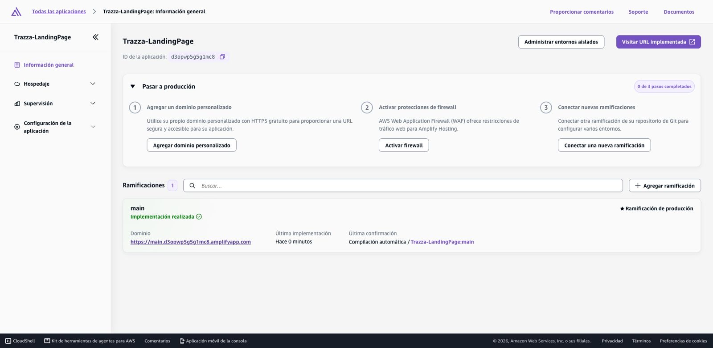
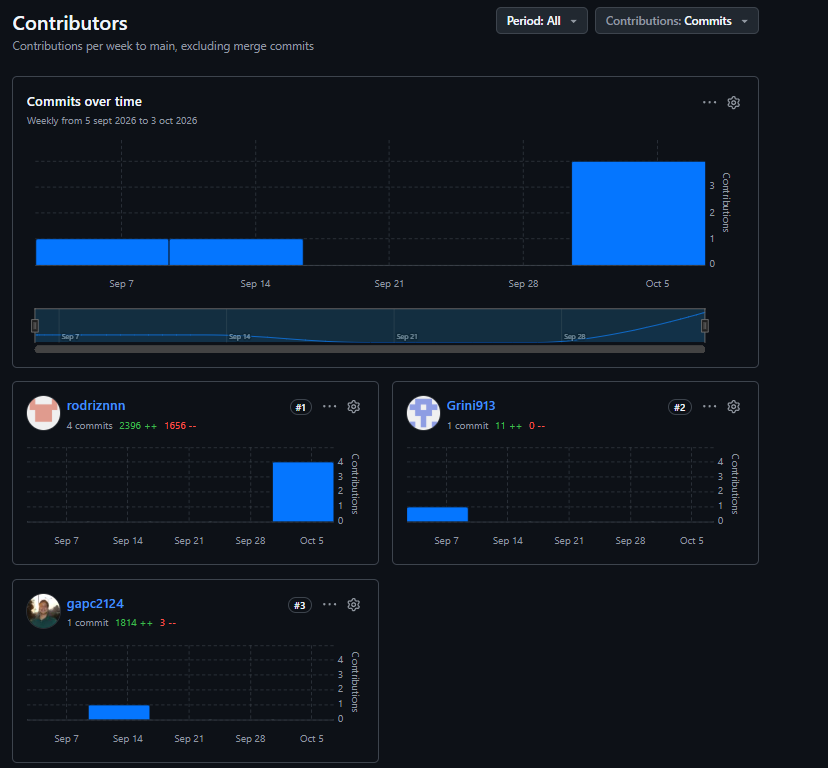
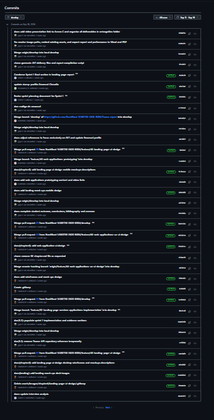

## 5.2. Landing Page, Services & Applications Implementation
 
En esta sección se explica y evidencia el proceso de implementación, pruebas, documentación y despliegue del Landing Page, los Web Services y la Frontend Web Application de Trazza, organizado por Sprint. En el Sprint 1 el equipo implementó y desplegó la primera versión del Landing Page. En el Sprint 2 se publicó una nueva versión del Landing Page y la primera versión de la Web Application, construida a partir de los diseños de la sección 4.4 sobre una API simulada. En el Sprint 3 se implementaron y desplegaron los Web Services en ASP.NET Core y se integró la Web Application con ellos.
 
### 5.2.1. Sprint 1
 
En esta sección se registra el avance en producto y en trabajo colaborativo del Sprint 1, cuyo alcance fue la primera versión del Landing Page, primer punto de contacto de Trazza con transportistas y comerciantes MYPE.
 
#### 5.2.1.1. Sprint Planning 1
 
En el Sprint Planning 1 el equipo definió el objetivo del Sprint y seleccionó las User Stories del Landing Page con mayor prioridad en el Product Backlog.
 
| Sprint # | Sprint 1 |
| :--- | :--- |
| **Sprint Planning Background** | |
| Date | 2026-09-18 |
| Time | 10:00 AM |
| Location | Reunión virtual vía Microsoft Teams |
| Prepared By | Peñaranda Caldas, Gabriel Augusto |
| Attendees (to planning meeting) | Checalla Apaza, Emanuel Renato / Lozano Quispe, Fabricio Jofred / Medina Merma, Ingrid Melani / Peñaranda Caldas, Gabriel Augusto / Vite Celis, Rodrigo Matias |
| Sprint 0 Review Summary | N/A. Es el primer Sprint del proyecto. |
| Sprint 0 Retrospective Summary | N/A. Es el primer Sprint del proyecto. |
| **Sprint Goal & User Stories** | |
| Sprint 1 Goal | **Nuestro enfoque está en** publicar la primera versión del Landing Page de Trazza, que presente la propuesta de valor para transportistas con viajes de retorno vacíos y para comerciantes MYPE que necesitan enviar mercadería por Lima. **Creemos que esto entrega** una primera razón clara para registrarse **a** transportistas independientes y comerciantes MYPE de Lima. **Esto se confirmará cuando** un visitante pueda abrir el Landing Page desde una URL pública, identificar la propuesta para su segmento, leer los testimonios y llegar al formulario de registro de su rol. |
| Sprint 1 Velocity | 5 Story Points |
| Sum of Story Points | 5 Story Points (US04: 2, US05: 2, US25: 1) |
 
#### 5.2.1.2. Aspect Leaders and Collaborators
 
Los aspectos del Sprint 1 son la implementación del Landing Page, el diseño de sus wireframes y mock-ups (sección 4.3) y su despliegue. Los líderes se asignaron según la participación registrada en los repositorios.
 
| Team Member (Last Name, First Name) | GitHub Username | Landing Page Implementation (L/C) | Landing Page UI Design (L/C) | Landing Page Deployment (L/C) |
| :--- | :--- | :---: | :---: | :---: |
| Checalla Apaza, Emanuel Renato | Emanuelca135 | C | C | L |
| Lozano Quispe, Fabricio Jofred | FabricioZz15 | C | L | C |
| Medina Merma, Ingrid Melani | Grini913 | C | C | C |
| Peñaranda Caldas, Gabriel Augusto | gapc2124 | L | C | C |
| Vite Celis, Rodrigo Matias | rodriznnn | C | C | C |
 
#### 5.2.1.3. Sprint Backlog 1
 
El objetivo del Sprint 1 fue publicar la primera versión del Landing Page. Las User Stories se descompusieron en tareas de 4 a 8 horas.
 
 
**URL público del Board:** [https://trazza.youtrack.cloud/agiles/204-1/current](https://trazza.youtrack.cloud/agiles/204-1/current)
 
| Sprint # | Sprint 1 | | | | | | |
| :--- | :--- | :--- | :--- | :--- | :--- | :--- | :--- |
| **User Story** | | **Work-Item / Task** | | | | | |
| **Id** | **Title** | **Id** | **Title** | **Description** | **Estimation (Hours)** | **Assigned To** | **Status** |
| US04 | Landing Page: Propuesta para Transportistas | T01 | Estructura base del repositorio | Crear el repositorio `Trazza-LandingPage` y la estructura inicial del sitio. | 4 | Medina Merma, Ingrid Melani | Done |
| US04 | Landing Page: Propuesta para Transportistas | T02 | Header, navegación y Hero | Implementar la barra de navegación responsive y la sección Hero con los botones por rol. | 6 | Peñaranda Caldas, Gabriel Augusto | Done |
| US04 | Landing Page: Propuesta para Transportistas | T03 | Sección para transportistas | Maquetar los beneficios para el transportista y el llamado a registrarse. | 4 | Peñaranda Caldas, Gabriel Augusto | Done |
| US05 | Landing Page: Propuesta para Emprendedores | T04 | Sección para comerciantes y comparativa | Maquetar los beneficios para el comerciante MYPE y la comparativa frente al flete tradicional. | 5 | Peñaranda Caldas, Gabriel Augusto | Done |
| US25 | Landing Page: Testimonios de Éxito | T05 | Testimonios y footer | Implementar las tarjetas de testimonios, la sección de contacto y el footer. | 4 | Peñaranda Caldas, Gabriel Augusto | Done |
| — | Constraint: despliegue | T06 | Despliegue en AWS Amplify | Conectar el repositorio con AWS Amplify, publicar la rama `main` y validar la URL pública. | 4 | Checalla Apaza, Emanuel Renato | Done |
 
#### 5.2.1.4. Development Evidence for Sprint Review
 
En el Sprint 1 se creó el repositorio del Landing Page y se implementó su primera versión, que luego se publicó en AWS Amplify. En paralelo se documentaron en el informe el diseño del Landing Page y la configuración del proyecto. La siguiente tabla muestra los commits relacionados con la implementación.
 
| Repository | Branch | Commit Id | Commit Message | Commit Message Body | Committed on (Date) |
| :--- | :--- | :--- | :--- | :--- | :--- |
| StackRoot-1ASI0730-2620-8084/Trazza-LandingPage | main | f5ef775 | first commit | - | 2026-09-11 |
| StackRoot-1ASI0730-2620-8084/Trazza-LandingPage | main | 27773c4 | feat: creando nuevo repositorio debido a los errores del anterior | - | 2026-09-18 |
| StackRoot-1ASI0730-2620-8084/Trazza-report | feature/43-landing-page-ui-design | 11323a7 | docs(landing): add landing wireframes images | - | 2026-09-18 |
| StackRoot-1ASI0730-2620-8084/Trazza-report | feature/43-landing-page-ui-design | be862b6 | docs(landing): add landing mock ups desk images | - | 2026-09-18 |
| StackRoot-1ASI0730-2620-8084/Trazza-report | feature/43-landing-page-ui-design | a05df02 | docs(chapter4): add landing page ui design desktop wireframes and mockups descriptions | - | 2026-09-18 |
| StackRoot-1ASI0730-2620-8084/Trazza-report | feature/51-software-configuration-management | 78675b9 | doc(5.1): add complete content for software configuration management | - | 2026-09-18 |
| StackRoot-1ASI0730-2620-8084/Trazza-report | feature/52-landing-page-services-applications-implementation | 84eb2d8 | doc(5.2): populate sprint 1 implementation and evidence sections | - | 2026-09-18 |
 
#### 5.2.1.5. Execution Evidence for Sprint Review
 
Al cierre del Sprint 1, el Landing Page quedó publicado en una URL pública. Presentaba la propuesta de valor para ambos segmentos, la comparativa frente al flete tradicional, los testimonios y los accesos al registro por rol.
 

  
    
  
    
  

**Video de navegación del Sprint 1:** [upc-pre-202620-1asi0730-8084-StackRoot-productnavigation-sprint-1.mp4](https://upcedupe-my.sharepoint.com/:v:/g/personal/u202414356_upc_edu_pe/IQAHwNmBh-BrSIywebxTh1XRAXSQ67CxwXjsw4F17WnJ3nQ?e=dc5eL3&nav=eyJyZWZlcnJhbEluZm8iOnsicmVmZXJyYWxBcHAiOiJTdHJlYW1XZWJBcHAiLCJyZWZlcnJhbFZpZXciOiJTaGFyZURpYWxvZy1MaW5rIiwicmVmZXJyYWxBcHBQbGF0Zm9ybSI6IldlYiIsInJlZmVycmFsTW9kZSI6InZpZXcifX0%3D)
 
#### 5.2.1.6. Services Documentation Evidence for Sprint Review
 
El alcance del Sprint 1 se limitó al Landing Page, que es un sitio estático. Por ello, en este Sprint no se implementaron ni documentaron endpoints con OpenAPI. Los Web Services de Trazza se implementarán en ASP.NET Core en un Sprint posterior.
 
#### 5.2.1.7. Software Deployment Evidence for Sprint Review
 
En el Sprint 1 se creó la aplicación en AWS Amplify Hosting y se conectó con la rama `main` del repositorio `Trazza-LandingPage`, siguiendo los pasos descritos en la sección 5.1.4. Al ser un sitio estático, no requiere comando de build. Desde entonces, cada cambio integrado en `main` se publica automáticamente.
 
**URL del Landing Page:** [https://main.d3opwp5g5g1mc8.amplifyapp.com](https://main.d3opwp5g5g1mc8.amplifyapp.com)
 

  

#### 5.2.1.8. Team Collaboration Insights during Sprint
 
En el Sprint 1 el equipo trabajó en dos repositorios. En `Trazza-LandingPage` se registraron 2 commits: Medina Merma, Ingrid Melani (estructura inicial) y Peñaranda Caldas, Gabriel Augusto (primera versión completa), ambos directamente en `main`. En `Trazza-report` cada sección del informe se trabajó en su rama `feature/*` y se integró a `develop` mediante Pull Requests, con commits de los cinco integrantes.
 
Los gráficos de Contributors muestran las contribuciones semanales de cada integrante. Las barras de las semanas del 7 y 14 de septiembre corresponden al Sprint 1.
 

  
    
  
    
  
    
  

### 5.2.2. Sprint 2

En esta sección se registra el avance en producto y en trabajo colaborativo correspondiente al Sprint 2.

#### 5.2.2.1. Sprint Planning 2

En el Sprint Planning 2 el equipo definió el objetivo del Sprint y seleccionó las User Stories correspondientes de acuerdo con su prioridad dentro del Product Backlog.

| Sprint # | Sprint 2 |
| :--- | :--- |
| **Sprint Planning Background** | |
| Date |05/10/2026 |
| Time | 10:00 p.m |
| Location | Modalidad Remota a través de la plataforma Discord |
| Prepared By |  Peñaranda Caldas, Gabriel Augusto |
| Attendees (to planning meeting) | Checalla Apaza, Emanuel Renato / Lozano Quispe, Fabricio Jofred / Medina Merma, Ingrid Melani / Peñaranda Caldas, Gabriel Augusto / Vite Celis, Rodrigo Matias |
| Sprint 1 Review Summary | En este sprint, el equipo avanzó en la primera versión funcional de Trazza, desarrollando la Landing Page y las funcionalidades iniciales de registro y autenticación. También se establecieron las bases para la integración y despliegue de los componentes del sistema. Como mejora, identificamos la necesidad de seguir refinando la experiencia de usuario y fortalecer la integración entre los diferentes módulos. |
| Sprint 1 Retrospective Summary | Durante este sprint, el equipo mantuvo una colaboración constante mediante la distribución de responsabilidades y el uso de GitHub para integrar los avances. Sin embargo, se identificaron oportunidades de mejora en la coordinación de tareas, comunicación e integración de cambios entre ramas. Para el siguiente sprint, buscaremos mejorar la organización del trabajo y mantener una comunicación más constante entre los integrantes. |
| **Sprint Goal & User Stories** | |
| Sprint 2 Goal | Nuestro enfoque es desplegar la primera versión funcional del frontend de la aplicación web de Trazza. Consideramos que esto permitirá a los usuarios contar con una primera interfaz funcional para interactuar con la plataforma. El objetivo se considerará cumplido cuando el frontend se encuentre desplegado y permita acceder y navegar correctamente por las principales vistas implementadas. |
| Sprint 2 Velocity |30 Story Points. |
| Sum of Story Points | 30 Story Points. |

#### 5.2.2.2. Aspect Leaders and Collaborators

En esta sección se presentan los líderes y colaboradores responsables de los principales aspectos desarrollados durante el Sprint 2.

| Team Member (Last Name, First Name) | GitHub Username | Landing Page Implementation (L/C) | Landing Page UI Design (L/C) | Landing Page Deployment (L/C) |
| :--- | :--- | :---: | :---: | :---: |
| Checalla Apaza, Emanuel Renato | Emanuelca135 | C | C | C |
| Lozano Quispe, Fabricio Jofred | FabricioZz15 | C | L | C |
| Medina Merma, Ingrid Melani | Grini913 | L | C | C |
| Peñaranda Caldas, Gabriel Augusto | gapc2124 | C | C | C |
| Vite Celis, Rodrigo Matias | rodriznnn | C | C | C |

#### 5.2.2.3. Sprint Backlog 2

El objetivo del Sprint 2 fue desplegar la primera versión del frontend de la Web Application. Las tareas se agruparon por bounded context y se trabajaron en el repositorio `trazza-webapp`. En paralelo se publicó una nueva versión del Landing Page en `trazza-website`.

**URL público del Board:** [Pendiente: URL del Board del Sprint 2](URL)

| Sprint # | Sprint 2 | | | | | | |
| :--- | :--- | :--- | :--- | :--- | :--- | :--- | :--- |
| **User Story** | | **Work-Item / Task** | | | | | |
| **Id** | **Title** | **Id** | **Title** | **Description** | **Estimation (Hours)** | **Assigned To** | **Status** |
| US04, US05 | Landing Page: propuesta por segmento | T01 | Traducción y rediseño del Landing Page | Traducir el sitio al inglés, actualizar el diseño y activar el selector de idioma EN / ES. | [Pendiente] | Vite Celis, Rodrigo Matias | Done |
| US04, US05 | Landing Page: propuesta por segmento | T02 | Fotos reales y limpieza de estilos | Reemplazar imágenes de carriers y merchants por fotos reales y depurar el CSS y el i18n. | [Pendiente] | Lozano Quispe, Fabricio Jofred | Done |
| US03 | Inicio de Sesión de Usuario | T03 | Enlace del Landing Page a la Web App | Conectar los botones de inicio de sesión del Landing Page con la Web Application desplegada. | [Pendiente] | Vite Celis, Rodrigo Matias | Done |
| US01, US02, US03 | Registro e inicio de sesión | T04 | Base del frontend e IAM | Crear el proyecto Vue + Vite con shared kernel, layout, router, i18n y las vistas de registro, inicio de sesión, perfil y vehículos. | [Pendiente] | Vite Celis, Rodrigo Matias | Done |
| US08 a US13 | Matchmaking & Routing | T05 | Vistas de rutas, solicitudes y ofertas | Implementar publicación de rutas de retorno, solicitudes de flete, sugerencias de carga, búsqueda de transportistas y ofertas. | [Pendiente] | Vite Celis, Rodrigo Matias | Done |
| US15 a US17, US24 | Service Execution & Monitoring | T06 | Vistas de viaje activo y seguimiento | Implementar viaje activo, seguimiento del envío e historiales de viajes y envíos. | [Pendiente] | Vite Celis, Rodrigo Matias | Done |
| — | Payment & Billing: planes de suscripción | T07 | Bounded context de Billing | Implementar value objects, agregados, API, store, rutas y la vista de planes y facturación. | [Pendiente] | Lozano Quispe, Fabricio Jofred | Done |
| — | Constraint: API simulada | T08 | Fake API con json-server | Exponer los recursos del frontend con `json-server` y apuntar `.env.production` al endpoint publicado. | [Pendiente] | Peñaranda Caldas, Gabriel Augusto | Done |
| — | Constraint: despliegue | T09 | Despliegue del frontend en AWS Amplify | Publicar la rama `main` de `trazza-webapp` en AWS Amplify Hosting. | [Pendiente] | [Pendiente] | Done |

#### 5.2.2.4. Development Evidence for Sprint Review

En el Sprint 2 se creó el repositorio `trazza-webapp` con la primera versión del frontend, se añadió el bounded context de Billing y se publicó una nueva versión del Landing Page. La siguiente tabla muestra los commits principales.

| Repository | Branch | Commit Id | Commit Message | Commit Message Body | Committed on (Date) |
| :--- | :--- | :--- | :--- | :--- | :--- |
| StackRoot-1ASI0730-2620-8084/trazza-website | main | 36e7cb1 | feat: translate landing page from Spanish to English | - | 2026-10-04 |
| StackRoot-1ASI0730-2620-8084/trazza-website | main | a128fa9 | feat: update landing page design | - | 2026-10-05 |
| StackRoot-1ASI0730-2620-8084/trazza-website | main | a5f1c06 | feat: make the EN \| ES language switch translate the site | - | 2026-10-05 |
| StackRoot-1ASI0730-2620-8084/trazza-website | main | bafb49f | feat: add real photos to the carriers and merchants sections | - | 2026-10-05 |
| StackRoot-1ASI0730-2620-8084/trazza-website | main | 7af16ae | docs: update i18n | - | 2026-10-06 |
| StackRoot-1ASI0730-2620-8084/trazza-website | main | 5ba8733 | feat: link sign in buttons to the web app | - | 2026-10-06 |
| StackRoot-1ASI0730-2620-8084/trazza-webapp | main | be8aed3 | Initial commit | - | 2026-10-05 |
| StackRoot-1ASI0730-2620-8084/trazza-webapp | feature/payment-billing | 286a341 | feat(billing): add subscription-plan value object | - | 2026-10-05 |
| StackRoot-1ASI0730-2620-8084/trazza-webapp | feature/payment-billing | 23362b8 | feat(billing): add payment-transaction aggregate | - | 2026-10-05 |
| StackRoot-1ASI0730-2620-8084/trazza-webapp | feature/payment-billing | 53caadd | feat(billing): add billing-api | - | 2026-10-05 |
| StackRoot-1ASI0730-2620-8084/trazza-webapp | feature/payment-billing | a0fd02f | feat(billing): add billing store | - | 2026-10-05 |
| StackRoot-1ASI0730-2620-8084/trazza-webapp | feature/payment-billing | 05c209a | feat(billing): add plan-billing view | - | 2026-10-05 |
| StackRoot-1ASI0730-2620-8084/trazza-webapp | feature/payment-billing | e0167dc | feat(billing): add billing-routes | - | 2026-10-05 |
| StackRoot-1ASI0730-2620-8084/trazza-webapp | main | 0ad54fa | chore: update API URL to EC2 DuckDNS endpoint | - | 2026-10-05 |
| StackRoot-1ASI0730-2620-8084/trazza-report | feature/52-landing-page-services-applications-implementation | fad3731 | docs: add 5.2.1 Sprint 1 to chapter 5 | - | 2026-10-05 |
| StackRoot-1ASI0730-2620-8084/trazza-report | develop | 1fad080 | docs: add part of sprint 2 documentation | - | 2026-10-05 |

#### 5.2.2.5. Execution Evidence for Sprint Review

Al cierre del Sprint 2, la Web Application quedó publicada con sus vistas principales por bounded context. En este Sprint las vistas consumían una API simulada con `json-server`, que se reemplazó por los Web Services reales en el Sprint 3.

| Evidence | Description | Related User Story | Status |
| :--- | :--- | :--- | :--- |
| Registro e inicio de sesión | Vistas `sign-up` y `sign-in` con elección de rol Carrier / Merchant. | US01, US02, US03 | Done |
| Perfil y vehículos | Vistas `profile`, `vehicle-list` y `vehicle-form`. | US23 | Done |
| Rutas de retorno y sugerencias | Vistas `return-route-form`, `return-route-list`, `load-suggestions` y `load-detail`. | US08, US10, US12, US13 | Done |
| Solicitudes de flete y ofertas | Vistas `freight-request-form`, `freight-request-list`, `find-carriers`, `offer-list` y `offer-detail`. | US09, US11, US13 | Done |
| Viaje y seguimiento | Vistas `active-trip`, `shipment-tracking`, `trip-history` y `shipment-history`. | US15, US16, US17, US24 | Done |
| Planes y calificaciones | Vistas `plan-billing` y `rating-list`. | US19, US20 | Done |
| Landing Page v2 | Sitio traducido EN / ES con fotos reales y botones enlazados a la Web App. | US04, US05, US25 | Done |

  <!-- Pendiente: capturas de la Web Application del Sprint 2 en assets/images/chapter5/ -->

**Video de navegación del Sprint 2:** [Pendiente: URL del video del Sprint 2](URL)

#### 5.2.2.6. Services Documentation Evidence for Sprint Review

En el Sprint 2 el frontend consumió una API simulada con `json-server` (carpeta `server/` del repositorio `trazza-webapp`, con `db.json` y `routes.json`). Las rutas `/api/v1/*` se redirigían a los recursos de `db.json`, de modo que el frontend usara desde el inicio el mismo prefijo que tendrían los Web Services reales. Al ser una API simulada, en este Sprint no se documentaron endpoints con OpenAPI. Los Web Services reales y su documentación se presentan en la sección 5.2.3.6.

| Endpoint / Service | Method | Description | Documentation Evidence |
| :--- | :---: | :--- | :--- |
| `/api/v1/*` (json-server) | GET, POST, PUT, PATCH, DELETE | Recursos simulados de los bounded contexts, servidos desde `server/db.json`. | `server/routes.json` en `trazza-webapp` (commit `be8aed3`) |

#### 5.2.2.7. Software Deployment Evidence for Sprint Review

En el Sprint 2 se publicó la Web Application en AWS Amplify Hosting. La API simulada se apuntó a un endpoint en EC2 con DuckDNS (commit `0ad54fa`). El Landing Page siguió publicándose desde AWS Amplify y sus botones de inicio de sesión se enlazaron a la Web App.

| Software Component | Deployment Platform | Repository / Branch | Deployment URL | Status |
| :--- | :--- | :--- | :--- | :--- |
| Landing Page v2 | AWS Amplify Hosting | trazza-website / main | [Pendiente: confirmar URL vigente del Landing Page] | Deployed |
| Web Application v1 | AWS Amplify Hosting | trazza-webapp / main | https://main.d1h7l9z3r6ucz4.amplifyapp.com | Deployed (reemplazada en el Sprint 3) |
| Fake API (json-server) | Amazon EC2 + DuckDNS | trazza-webapp / main (`server/`) | https://trazza-api.duckdns.org/api/v1 | Deployed (retirada en el Sprint 3) |

  <!-- Pendiente: captura del despliegue del Sprint 2 en AWS Amplify, en assets/images/chapter5/ -->

#### 5.2.2.8. Team Collaboration Insights during Sprint

En el Sprint 2 el equipo trabajó en tres repositorios. En `trazza-webapp` el bounded context de Billing se trabajó en la rama `feature/payment-billing` y se integró a `main` mediante el Pull Request #1. En `trazza-website` los cambios se hicieron directamente en `main`. En `trazza-report` cada sección se trabajó en su rama `feature/*` y se integró a `develop` mediante Pull Requests.

| Team Member | GitHub Username | Repository | Commits | Pull Requests | Main Contribution |
| :--- | :--- | :--- | :---: | :---: | :--- |
| Checalla Apaza, Emanuel Renato | Emanuelca135 | trazza-website, trazza-webapp | 2 | 0 | Ajustes del `index.html` del Landing Page y licencia de la Web App. |
| Lozano Quispe, Fabricio Jofred | FabricioZz15 | trazza-webapp, trazza-website, trazza-report | 31 | 7 | Bounded context de Billing, estilos e i18n del Landing Page, capítulos 4 y 5 del informe. |
| Medina Merma, Ingrid Melani | grini913 | trazza-report | 12 | 0 | Diagramas C4, diagramas de clases y diseño de base de datos. |
| Peñaranda Caldas, Gabriel Augusto | gapc2024 | trazza-webapp, trazza-report | 17 | 0 | Endpoint de la API simulada, Product Backlog, Impact Map y correcciones de los capítulos 1 a 3. |
| Vite Celis, Rodrigo Matias | rodriznnn | trazza-webapp, trazza-website, trazza-report | 12 | 0 | Base del frontend con todas sus vistas, rediseño EN / ES del Landing Page y mock-ups del capítulo 4. |

Los conteos consideran commits sin merges con fecha entre el 19 de septiembre y el 6 de octubre de 2026. Los Pull Requests de `trazza-report` (#7 a #12) y de `trazza-webapp` (#1) figuran a nombre de quien los abrió.

  <!-- Pendiente: capturas de GitHub Insights (Contributors) de trazza-webapp y trazza-website en el Sprint 2 -->

### 5.2.3. Sprint 3

En esta sección se registra el avance en producto y en trabajo colaborativo del Sprint 3, cuyo alcance fueron los Web Services de Trazza en ASP.NET Core, su despliegue en AWS y la integración de la Web Application con ellos.

#### 5.2.3.1. Sprint Planning 3

En el Sprint Planning 3 el equipo definió el objetivo del Sprint y seleccionó las User Stories de Web Services y las funcionalidades que dependen de ellos dentro del Product Backlog.

| Sprint # | Sprint 3 |
| :--- | :--- |
| **Sprint Planning Background** | |
| Date | [Pendiente: fecha del Sprint Planning 3] |
| Time | [Pendiente: hora] |
| Location | [Pendiente: lugar o plataforma de la reunión] |
| Prepared By | Peñaranda Caldas, Gabriel Augusto |
| Attendees (to planning meeting) | [Pendiente: confirmar asistentes] |
| Sprint 2 Review Summary | [Pendiente: resumen del Sprint 2 Review redactado por el equipo] |
| Sprint 2 Retrospective Summary | [Pendiente: resumen de la Sprint 2 Retrospective redactado por el equipo] |
| **Sprint Goal & User Stories** | |
| Sprint 3 Goal | **Nuestro enfoque está en** implementar y desplegar los Web Services de Trazza para los cinco bounded contexts e integrar la Web Application con ellos, reemplazando la API simulada del Sprint 2. **Creemos que esto entrega** un flujo real de punta a punta, desde la publicación de una ruta o solicitud hasta la entrega, la liquidación y la calificación, **a** transportistas independientes y comerciantes MYPE de Lima. **Esto se confirmará cuando** un usuario pueda registrarse, publicar, emparejarse, seguir un viaje y calificar en la Web Application desplegada, con los datos guardados en la base de datos a través de la API documentada con OpenAPI. |
| Sprint 3 Velocity | [Pendiente: velocity acordada por el equipo] |
| Sum of Story Points | 65 Story Points (US06: 5, US07: 5, US14: 5, US18: 5, US22: 5, US26: 8, US28: 8, US29: 8, US30: 8, US31: 8) |

#### 5.2.3.2. Aspect Leaders and Collaborators

Los aspectos del Sprint 3 corresponden a los bounded contexts de los Web Services y de su integración en la Web Application, más el Shared Kernel y el despliegue. Los líderes se asignaron según la participación registrada en los repositorios `trazza-platform` y `trazza-webapp`.

| Team Member (Last Name, First Name) | GitHub Username | IAM & Fleet (L/C) | Matchmaking & Routing (L/C) | Service Execution & Monitoring (L/C) | Payment & Billing (L/C) | Loyalty & Reputation (L/C) | Shared Kernel & Deployment (L/C) |
| :--- | :--- | :---: | :---: | :---: | :---: | :---: | :---: |
| Checalla Apaza, Emanuel Renato | Emanuelca135 | L | C | C | C | C | C |
| Lozano Quispe, Fabricio Jofred | FabricioZz15 | C | C | C | L | C | C |
| Medina Merma, Ingrid Melani | grini913 | C | C | L | C | C | C |
| Peñaranda Caldas, Gabriel Augusto | gapc2024 | C | L | C | C | C | L |
| Vite Celis, Rodrigo Matias | rodriznnn | C | C | C | C | L | C |

#### 5.2.3.3. Sprint Backlog 3

El objetivo del Sprint 3 fue implementar y desplegar los Web Services e integrar la Web Application. Cada bounded context se trabajó en su rama `feature/*` de `trazza-platform` y `trazza-webapp`, y se integró a `develop` mediante Pull Requests.

**URL público del Board:** [Pendiente: URL del Board del Sprint 3](URL)

| Sprint # | Sprint 3 | | | | | | |
| :--- | :--- | :--- | :--- | :--- | :--- | :--- | :--- |
| **User Story** | | **Work-Item / Task** | | | | | |
| **Id** | **Title** | **Id** | **Title** | **Description** | **Estimation (Hours)** | **Assigned To** | **Status** |
| — | Constraint: Shared Kernel | T01 | Shared Kernel de la API | Implementar `AggregateRoot`, `Result<T>`, `Money`, `LimaCalendar`, unit of work, repositorio base, interceptores, convenciones snake_case y kebab-case y `ProblemDetails` localizados. | [Pendiente] | Peñaranda Caldas, Gabriel Augusto | Done |
| US06, US07 | Autenticación y registro vía API | T02 | IAM & Fleet en la API | Implementar registro, inicio de sesión con JWT y refresh token, y la gestión de vehículos, conductores y direcciones guardadas. | [Pendiente] | Checalla Apaza, Emanuel Renato | Done |
| US26 | Validación de Identidad (KYC) | T03 | Verificación de identidad simulada | Guardar la identidad cifrada (AES-GCM) y verificarla contra un proveedor RENIEC simulado. | [Pendiente] | Checalla Apaza, Emanuel Renato | Done |
| US14 | Consulta de Rutas Disponibles vía API | T04 | Matchmaking & Routing en la API | Implementar rutas de retorno, solicitudes de envío, búsqueda, sugerencias por corredor y propuestas de match. | [Pendiente] | Peñaranda Caldas, Gabriel Augusto | Done |
| US29 | Mensajería Integrada (Chat) | T05 | Mensajes dentro de la propuesta | Exponer el envío, la lectura y el listado de mensajes de cada propuesta de match. | [Pendiente] | Peñaranda Caldas, Gabriel Augusto | Done |
| US18 | Registro de Ubicación GPS vía API | T06 | Service Execution & Monitoring en la API | Implementar el ciclo de vida del viaje, los puntos de tracking, las incidencias y el listado de dispositivos IoT. | [Pendiente] | Medina Merma, Ingrid Melani | Done |
| US30 | Alerta de Desvío en Ruta | T07 | Alertas de desvío y simulador GPS | Generar alertas cuando el vehículo sale del corredor de la ruta y añadir un simulador GPS para probar el seguimiento. | [Pendiente] | Peñaranda Caldas, Gabriel Augusto | Done |
| US28, US31 | Lucro cesante y confirmación de pago | T08 | Payment & Billing en la API | Implementar planes, suscripciones con pago simulado, liquidaciones de flete y compensaciones por cancelación. | [Pendiente] | Lozano Quispe, Fabricio Jofred | Done |
| US22 | Registro de Calificaciones vía API | T09 | Loyalty & Reputation en la API | Implementar calificaciones mutuas, resumen de reputación y puntos de fidelidad con canjes. | [Pendiente] | Vite Celis, Rodrigo Matias | Done |
| US06, US07 | Autenticación y registro vía API | T10 | Integración de IAM en la Web App | Reemplazar `json-server` por la API, autenticar con JWT, refrescar la sesión ante un 401 y completar perfil, conductores y direcciones. | [Pendiente] | Peñaranda Caldas, Gabriel Augusto | Done |
| US14, US29 | Matchmaking en la Web App | T11 | Integración de Matchmaking | Consumir los endpoints de rutas, solicitudes y propuestas desde la Web App. | [Pendiente] | Peñaranda Caldas, Gabriel Augusto | Done |
| US18, US30 | Seguimiento en la Web App | T12 | Viajes y mapas en vivo | Añadir mapas con Leaflet, la vista de viajes y el seguimiento en vivo. | [Pendiente] | Peñaranda Caldas, Gabriel Augusto | Done |
| US28, US31 | Billing en la Web App | T13 | Integración de Billing | Añadir las vistas de planes, suscripciones y liquidaciones conectadas a la API. | [Pendiente] | Lozano Quispe, Fabricio Jofred | Done |
| US22 | Reputación en la Web App | T14 | Integración de Loyalty & Reputation | Rehacer el store, la API, el diálogo de calificación y añadir la vista de puntos de fidelidad. | [Pendiente] | Vite Celis, Rodrigo Matias | Done |
| — | Constraint: despliegue | T15 | Despliegue de la API y la Web App | Publicar la API detrás de Amazon CloudFront con base de datos MySQL en Amazon RDS, y la Web App en AWS Amplify. | [Pendiente] | Peñaranda Caldas, Gabriel Augusto | Done |

#### 5.2.3.4. Development Evidence for Sprint Review

En el Sprint 3 se creó el repositorio `trazza-platform` con los Web Services en ASP.NET Core (.NET 10), organizados en cinco bounded contexts y un Shared Kernel, y se publicó su versión `v1.0.0`. En `trazza-webapp` se retiró la API simulada y se integraron todas las vistas con los Web Services. La siguiente tabla muestra los commits principales de cada bounded context.

| Repository | Branch | Commit Id | Commit Message | Commit Message Body | Committed on (Date) |
| :--- | :--- | :--- | :--- | :--- | :--- |
| StackRoot-1ASI0730-2620-8084/trazza-platform | feature/profiles | 8fc7d3d | chore: initial project structure | - | 2026-11-03 |
| StackRoot-1ASI0730-2620-8084/trazza-platform | feature/reputation | 8f5587e | feat(reputation): add rating aggregate root | - | 2026-11-04 |
| StackRoot-1ASI0730-2620-8084/trazza-platform | feature/reputation | 127f342 | feat(reputation): add ratings controller | - | 2026-11-05 |
| StackRoot-1ASI0730-2620-8084/trazza-platform | feature/billing | eb3f18e | feat(billing): implement payment transaction and receipt aggregates with domain events and errors | - | 2026-11-05 |
| StackRoot-1ASI0730-2620-8084/trazza-platform | develop | 4f702c8 | feat(shared): adding aggregate root base class | - | 2026-11-10 |
| StackRoot-1ASI0730-2620-8084/trazza-platform | develop | dc25f5a | feat(shared): add application database context | - | 2026-11-11 |
| StackRoot-1ASI0730-2620-8084/trazza-platform | develop | 2ce177a | feat(shared): add global exception handler | - | 2026-11-11 |
| StackRoot-1ASI0730-2620-8084/trazza-platform | develop | f681ec4 | feat(shared): add database health check endpoint | - | 2026-11-11 |
| StackRoot-1ASI0730-2620-8084/trazza-platform | feature/iam | d37aacc | feat(iam): add domain aggregates for users, profiles, fleet and verifications | - | 2026-11-12 |
| StackRoot-1ASI0730-2620-8084/trazza-platform | feature/iam | dd823bc | feat(infrastructure): implement IAM infrastructure services and persistence | - | 2026-11-12 |
| StackRoot-1ASI0730-2620-8084/trazza-platform | develop | 7f6e898 | feat(matchmaking): add domain layer | - | 2026-11-12 |
| StackRoot-1ASI0730-2620-8084/trazza-platform | develop | b76bae5 | feat(matchmaking): add application and infrastructure layers | - | 2026-11-12 |
| StackRoot-1ASI0730-2620-8084/trazza-platform | develop | df79bfe | feat(matchmaking): add interfaces and integration | - | 2026-11-12 |
| StackRoot-1ASI0730-2620-8084/trazza-platform | feature/billing | c38ff79 | feat(billing): add subscription aggregate with vehicles and simulated payments | - | 2026-11-12 |
| StackRoot-1ASI0730-2620-8084/trazza-platform | feature/billing | 951b1d9 | feat(billing): add freight settlement and cancellation compensation aggregates | - | 2026-11-12 |
| StackRoot-1ASI0730-2620-8084/trazza-platform | feature/reputation | 62cb0f8 | feat(reputation): add rating and loyalty point entry aggregates | - | 2026-11-12 |
| StackRoot-1ASI0730-2620-8084/trazza-platform | feature/reputation | 6a60b97 | feat(reputation): add ratings and loyalty controllers | - | 2026-11-12 |
| StackRoot-1ASI0730-2620-8084/trazza-platform | feature/execution | e8d2fcf | feat: implement domain logic for trip execution and monitoring | - | 2026-11-13 |
| StackRoot-1ASI0730-2620-8084/trazza-platform | feature/execution | 954edc5 | feat: implement execution controllers, resources, and context facades | - | 2026-11-13 |
| StackRoot-1ASI0730-2620-8084/trazza-platform | develop | 9f925b9 | feat: create trip when proposal is accepted | - | 2026-11-13 |
| StackRoot-1ASI0730-2620-8084/trazza-platform | feature/matchmaking | e21dc27 | feat: add matchmaking suggestions and listings | - | 2026-11-13 |
| StackRoot-1ASI0730-2620-8084/trazza-platform | feature/gps-simulator | 60c11ca | feat: add gps simulator | - | 2026-11-13 |
| StackRoot-1ASI0730-2620-8084/trazza-platform | feature/shared | f9ff868 | feat: expose openapi in all environments | - | 2026-11-13 |
| StackRoot-1ASI0730-2620-8084/trazza-platform | develop | 8b18a8e | docs: update project documentation and api reference | - | 2026-11-13 |
| StackRoot-1ASI0730-2620-8084/trazza-platform | develop | 835998b | chore(release): v1.0.0 | - | 2026-11-13 |
| StackRoot-1ASI0730-2620-8084/trazza-webapp | develop | c05cd36 | feat(reputation): add score value object | - | 2026-10-29 |
| StackRoot-1ASI0730-2620-8084/trazza-webapp | develop | 70b58f6 | chore: remove json-server mock api | - | 2026-11-03 |
| StackRoot-1ASI0730-2620-8084/trazza-webapp | develop | d26133c | feat(iam): authenticate against platform api with jwt | - | 2026-11-03 |
| StackRoot-1ASI0730-2620-8084/trazza-webapp | feature/payment-billing | 027f978 | refactor(billing): call plans, subscriptions and settlements endpoints in billing-api | - | 2026-11-12 |
| StackRoot-1ASI0730-2620-8084/trazza-webapp | feature/payment-billing | 16c7633 | feat(billing): add subscription-list view | - | 2026-11-12 |
| StackRoot-1ASI0730-2620-8084/trazza-webapp | feature/loyalty-reputation | 35b05b6 | refactor(reputation): update reputation api for ratings and loyalty | - | 2026-11-12 |
| StackRoot-1ASI0730-2620-8084/trazza-webapp | feature/loyalty-reputation | d08f960 | feat(reputation): add loyalty points view | - | 2026-11-12 |
| StackRoot-1ASI0730-2620-8084/trazza-webapp | fix/iam-api-contract | 047b649 | fix: align iam with platform api | - | 2026-11-12 |
| StackRoot-1ASI0730-2620-8084/trazza-webapp | feature/iam-profiles | 253d6ef | fix: refresh session on 401 | - | 2026-11-13 |
| StackRoot-1ASI0730-2620-8084/trazza-webapp | feature/iam-profiles | f00b94e | feat: add drivers and saved addresses views | - | 2026-11-13 |
| StackRoot-1ASI0730-2620-8084/trazza-webapp | feature/matchmaking-routing | 3ab6a7e | feat: use matchmaking api | - | 2026-11-13 |
| StackRoot-1ASI0730-2620-8084/trazza-webapp | feature/service-execution-monitoring | 36c9ef8 | feat: add leaflet maps | - | 2026-11-13 |
| StackRoot-1ASI0730-2620-8084/trazza-webapp | feature/service-execution-monitoring | 9a2bc09 | feat: add trips and live tracking | - | 2026-11-13 |
| StackRoot-1ASI0730-2620-8084/trazza-webapp | fix/i18n-env | a4269b7 | chore: update endpoint env vars | - | 2026-11-13 |
| StackRoot-1ASI0730-2620-8084/trazza-website | main | 461ca88 | feat: link landing CTAs to web app | - | 2026-11-12 |

#### 5.2.3.5. Execution Evidence for Sprint Review

Al cierre del Sprint 3, la Web Application quedó integrada con los Web Services desplegados. Un usuario puede registrarse, verificar su identidad, publicar rutas o solicitudes, negociar una propuesta, seguir el viaje en un mapa, confirmar la entrega, revisar su liquidación y calificar a su contraparte.

| Evidence | Description | Related User Story | Status |
| :--- | :--- | :--- | :--- |
| Registro e inicio de sesión con JWT | La Web App se autentica contra `/api/v1/authentication` y renueva la sesión con el refresh token. | US06, US07 | Done |
| Verificación de identidad | Registro de DNI cifrado y verificación contra el proveedor RENIEC simulado. | US26 | Done |
| Rutas, solicitudes y propuestas | Búsqueda de rutas disponibles, sugerencias por corredor y propuestas de match aceptadas o rechazadas. | US14 | Done |
| Chat de la propuesta | Mensajes entre transportista y comerciante dentro de cada propuesta. | US29 | Done |
| Viaje y seguimiento en vivo | Mapa con Leaflet, puntos de tracking y simulador GPS. | US18 | Done |
| Alertas de desvío | Alertas cuando el vehículo sale del corredor de la ruta, con su reconocimiento. | US30 | Done |
| Liquidación y compensación | Confirmación de la liquidación del flete y compensación por cancelación en ruta. | US28, US31 | Done |
| Calificaciones y fidelidad | Calificación mutua tras el viaje, resumen de reputación y puntos de fidelidad. | US22 | Done |

  <!-- Pendiente: capturas de la Web Application del Sprint 3 en assets/images/chapter5/ -->

**Video de navegación del Sprint 3:** [Pendiente: URL del video del Sprint 3](URL)

#### 5.2.3.6. Services Documentation Evidence for Sprint Review

Los Web Services se documentaron con OpenAPI y se publican de forma interactiva con Scalar. Las rutas siguen el prefijo `/api/v1`, usan nombres en kebab-case y devuelven errores con el formato RFC 9457 `ProblemDetails`, localizados en español o inglés según el encabezado `Accept-Language`. Salvo el registro, el inicio de sesión, la renovación del token y el health check, todos los endpoints requieren el encabezado `Authorization: Bearer <token>`. La especificación publicada expone 83 operaciones agrupadas en 18 tags. El catálogo completo está en `docs/endpoints.md` del repositorio `trazza-platform`.

**Documentación interactiva (Scalar):** [https://d3mwl1okiudzcg.cloudfront.net/scalar/v1](https://d3mwl1okiudzcg.cloudfront.net/scalar/v1)

**Especificación OpenAPI:** [https://d3mwl1okiudzcg.cloudfront.net/openapi/v1.json](https://d3mwl1okiudzcg.cloudfront.net/openapi/v1.json)

| Endpoint / Service | Method | Description | Documentation Evidence |
| :--- | :---: | :--- | :--- |
| `/api/v1/authentication/sign-up` · `sign-in` · `refresh` · `sign-out` | POST | Registro, inicio de sesión con JWT, renovación y revocación del refresh token. | Scalar · tag Authentication |
| `/api/v1/users/me` · `/identity` · `/roles` · `/merchant-profile` | GET, PUT, POST | Perfil del usuario autenticado, identidad cifrada, activación de rol y perfil de comerciante. | Scalar · tag Users |
| `/api/v1/users/me/identity-verifications` | GET, POST | Verificación de identidad contra el proveedor RENIEC simulado. | Scalar · tag Users |
| `/api/v1/vehicles` · `/drivers` · `/saved-addresses` | GET, POST, PUT, DELETE | Flota del transportista y direcciones guardadas del comerciante. | Scalar · tags Vehicles, Drivers, SavedAddresses |
| `/api/v1/return-routes` (`/mine`, `/search`, `/{id}/suggested-shipments`, `/{id}/cancel`) | GET, POST | Publicación, búsqueda, sugerencias de envíos y cancelación de rutas de retorno. | Scalar · tag Return routes |
| `/api/v1/shipment-requests` (`/open`, `/mine`, `/search`, `/{id}/suggested-routes`, `/{id}/cancel`) | GET, POST | Publicación, búsqueda, sugerencias de rutas y cancelación de solicitudes de envío. | Scalar · tag Shipment requests |
| `/api/v1/match-proposals` (`/{id}/accept`, `/reject`, `/cancel`, `/messages`) | GET, POST | Propuestas de match, su respuesta y los mensajes entre las partes. Aceptar una propuesta crea el viaje. | Scalar · tags Match proposals, Messages |
| `/api/v1/trips` (`/{id}/driver`, `/pick-up`, `/deliver`, `/confirm`, `/cancel`, `/status-history`) | GET, PUT, POST | Ciclo de vida del viaje, desde la asignación del conductor hasta la confirmación de la entrega. | Scalar · tag Trips |
| `/api/v1/trips/{id}/tracking-points` · `/deviation-alerts` · `/incidents` | GET, POST | Puntos GPS, alertas de desvío con reconocimiento e incidencias con evidencias. | Scalar · tag Trips |
| `/api/v1/iot-devices` | GET | Listado de dispositivos IoT disponibles. | Scalar · tag IotDevices |
| `/api/v1/plans` · `/subscriptions` (`/{id}/renew`, `/{id}/cancel`) | GET, POST | Catálogo de planes y suscripción del transportista con pago simulado. | Scalar · tags Plans, Subscriptions |
| `/api/v1/freight-settlements` · `/cancellation-compensations` | GET, POST | Liquidación del flete por viaje y compensaciones por cancelación (confirmar, condonar o disputar). | Scalar · tags FreightSettlements, CancellationCompensations |
| `/api/v1/ratings` (`/received`, `/given`, `/summary/{userId}`) | GET, POST | Calificaciones mutuas y resumen de reputación. | Scalar · tag Ratings |
| `/api/v1/loyalty/points` · `/loyalty/redemptions` | GET, POST | Saldo y canje de puntos de fidelidad. | Scalar · tag Loyalty |
| `/api/v1/health` | GET | Estado de la API y de la conexión con la base de datos. | Scalar · tag Health |

  <!-- Pendiente: capturas de Scalar (listado de endpoints y una petición de ejemplo) en assets/images/chapter5/ -->

#### 5.2.3.7. Software Deployment Evidence for Sprint Review

En el Sprint 3 se desplegaron los Web Services y se publicó una nueva versión de la Web Application. La API se ejecuta sobre Kestrel detrás de una distribución de Amazon CloudFront y usa una base de datos MySQL 8 en Amazon RDS. Sus credenciales y el secreto del token se leen de variables de entorno. La Web Application se publica en AWS Amplify Hosting y lee la URL de la API desde la variable `VITE_TRAZZA_PLATFORM_API_URL` de `.env.production`. El Landing Page se actualizó para que sus botones de registro e inicio de sesión lleven a la nueva Web App.

| Software Component | Deployment Platform | Repository / Branch | Deployment URL | Status |
| :--- | :--- | :--- | :--- | :--- |
| Web Services (Trazza Platform v1.0.0) | Amazon CloudFront + [Pendiente: servicio de cómputo] + Amazon RDS (MySQL 8) | trazza-platform / main | https://d3mwl1okiudzcg.cloudfront.net/api/v1 | Deployed |
| Web Application | AWS Amplify Hosting | trazza-webapp / main | https://main.d32sst26l9v5eu.amplifyapp.com | Deployed |
| Landing Page | AWS Amplify Hosting | trazza-website / main | [Pendiente: confirmar URL vigente del Landing Page] | Deployed |

El endpoint `GET /api/v1/health` de la API desplegada responde `{"status":"healthy","database":"connected"}`, lo que confirma la conexión con la base de datos.

  <!-- Pendiente: capturas de AWS Amplify, CloudFront y RDS en assets/images/chapter5/ -->

#### 5.2.3.8. Team Collaboration Insights during Sprint

En el Sprint 3 el equipo trabajó en `trazza-platform` y `trazza-webapp` con GitFlow: cada bounded context se desarrolló en su rama `feature/*`, los ajustes de integración en ramas `fix/*`, y todo se integró a `develop` mediante Pull Requests. En `trazza-platform` la versión `v1.0.0` se integró a `main` con el Pull Request #11. En `trazza-webapp` el Pull Request de release (#11) quedó abierto al cierre del Sprint.

| Team Member | GitHub Username | Repository | Commits | Pull Requests | Main Contribution |
| :--- | :--- | :--- | :---: | :---: | :--- |
| Checalla Apaza, Emanuel Renato | Emanuelca135 | trazza-platform | 10 | 1 | Bounded context IAM & Fleet de la API: agregados, servicios, persistencia y controladores. |
| Lozano Quispe, Fabricio Jofred | FabricioZz15 | trazza-platform, trazza-webapp | 42 | 0 | Bounded context Payment & Billing en la API y en la Web App: planes, suscripciones, liquidaciones y compensaciones. |
| Medina Merma, Ingrid Melani | grini913 | trazza-platform, trazza-report | 4 | 0 | Bounded context Service Execution & Monitoring de la API y diseño de entrevistas de la sección 5.3. |
| Peñaranda Caldas, Gabriel Augusto | gapc2024 | trazza-platform, trazza-webapp, trazza-website | 86 | 18 | Shared Kernel, Matchmaking & Routing, simulador GPS, integración de la Web App con la API, release v1.0.0 y despliegue. |
| Vite Celis, Rodrigo Matias | rodriznnn | trazza-platform, trazza-webapp | 55 | 2 | Bounded context Loyalty & Reputation en la API y en la Web App: calificaciones y puntos de fidelidad. |

Los conteos consideran commits sin merges con fecha entre el 7 de octubre y el 13 de noviembre de 2026. Los Pull Requests figuran a nombre de quien los abrió.

  <!-- Pendiente: capturas de GitHub Insights (Contributors y Network) de trazza-platform y trazza-webapp en el Sprint 3 -->

