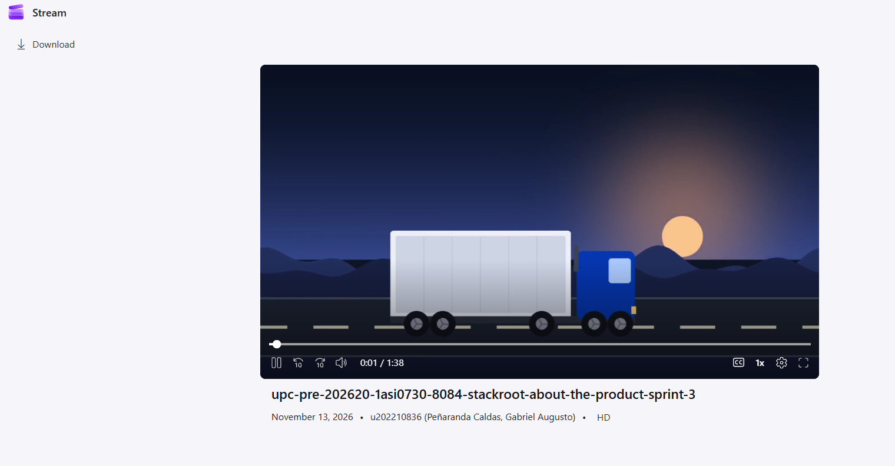

## 5.4. Video About-the-Product

En esta sección se presenta el video About-the-Product de Trazza. El video muestra el problema que resuelve el producto, la propuesta de valor para cada segmento objetivo y un recorrido por la Web Application desplegada, desde la publicación de una ruta de retorno hasta la entrega y la calificación.

**Video About-the-Product:** [upc-pre-202620-1asi0730-8084-StackRoot-about-the-product.mp4](https://upcedupe-my.sharepoint.com/:v:/g/personal/u202210836_upc_edu_pe/IQD1-IK_epZGTZKrEFRst6qDAU6rktjplwp50qp62ap0yL8?e=8TN8xq&nav=eyJyZWZlcnJhbEluZm8iOnsicmVmZXJyYWxBcHAiOiJTdHJlYW1XZWJBcHAiLCJyZWZlcnJhbFZpZXciOiJTaGFyZURpYWxvZy1MaW5rIiwicmVmZXJyYWxBcHBQbGF0Zm9ybSI6IldlYiIsInJlZmVycmFsTW9kZSI6InZpZXcifX0%3D)

  

| Campo | Detalle |
| :--- | :--- |
| Duración | 1:38 minutos |
| Plataforma de publicación | Microsoft Stream |
| Fecha de publicación | 13/11/2026 |
| Participantes | Checalla Apaza, Emanuel Renato / Lozano Quispe, Fabricio Jofred / Medina Merma, Ingrid Melani / Peñaranda Caldas, Gabriel Augusto / Vite Celis, Rodrigo Matias |

### Guion del video

El guion se organiza en escenas. Cada escena indica qué se muestra en pantalla y qué se narra.

| # | Escena | Qué se muestra | Narración |
| :---: | :--- | :--- | :--- |
| 1 | Problema | Imágenes de camiones regresando vacíos por Lima y de un comerciante buscando flete. | En Lima muchos transportistas vuelven de sus entregas con el camión vacío, mientras los comerciantes MYPE pagan fletes caros o informales para mover su mercadería. |
| 2 | Qué es Trazza | Hero del Landing Page con los botones "Soy Transportista" y "Soy Emprendedor". | Trazza conecta la capacidad libre de los viajes de retorno con los envíos de los comerciantes MYPE de Lima. |
| 3 | Propuesta para el transportista | Sección de beneficios para transportistas del Landing Page. | El transportista aprovecha su viaje de vuelta para ganar un ingreso adicional, sin pagar comisión por flete. |
| 4 | Propuesta para el emprendedor | Sección de beneficios para emprendedores y la comparativa frente al flete tradicional. | El comerciante encuentra transporte con espacio libre en su ruta y sigue su mercadería en todo momento. |
| 5 | Registro y verificación | Registro con elección de rol y verificación de identidad en la Web App. | Cada usuario se registra con su rol y verifica su identidad para generar confianza entre las partes. |
| 6 | Publicar ruta y solicitud | Formulario de ruta de retorno (Carrier) y formulario de solicitud de envío (Merchant). | El transportista publica su ruta y capacidad, y el comerciante publica lo que necesita enviar. |
| 7 | Sugerencias y propuesta | Cargas sugeridas, detalle de la propuesta y chat entre las partes. | Trazza sugiere las combinaciones compatibles por corredor y las partes acuerdan la tarifa en una propuesta. |
| 8 | Viaje y seguimiento | Viaje activo, mapa en vivo y una alerta de desvío. | Al aceptar la propuesta se crea el viaje. El comerciante sigue su envío en el mapa y recibe una alerta si el camión se desvía. |
| 9 | Entrega, liquidación y calificación | Confirmación de entrega, liquidación del flete y diálogo de calificación. | Al confirmar la entrega se registra la liquidación y ambos se califican para construir su reputación. |
| 10 | Planes y cierre | Sección de planes y URL del Landing Page. | Trazza ofrece planes de suscripción para transportistas. Visítanos y empieza a mover Lima con tus viajes de retorno. |
