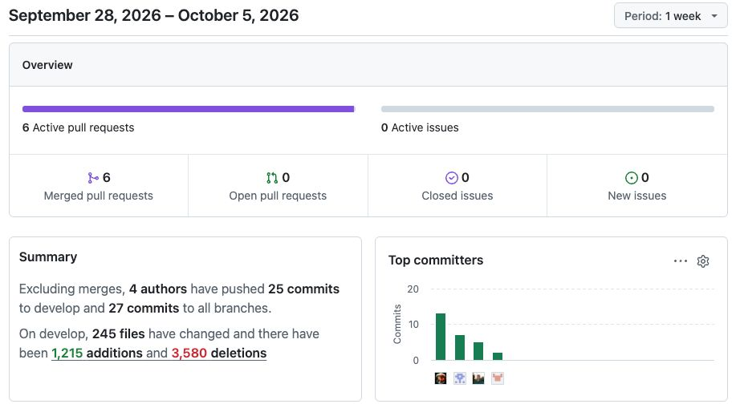
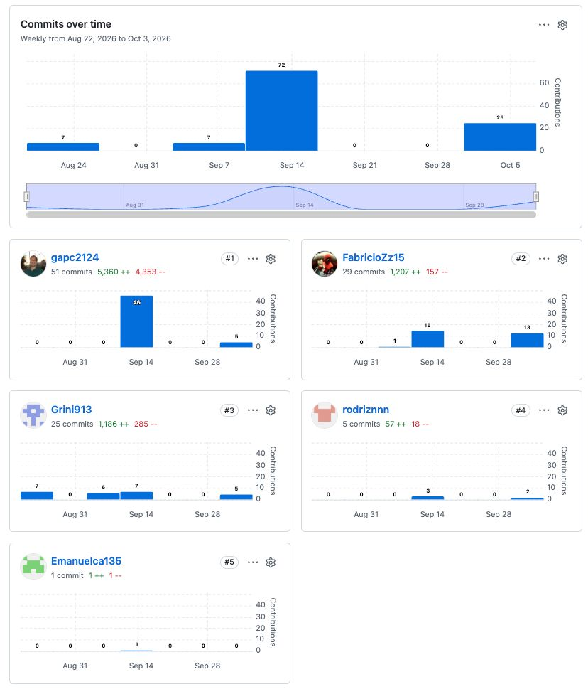
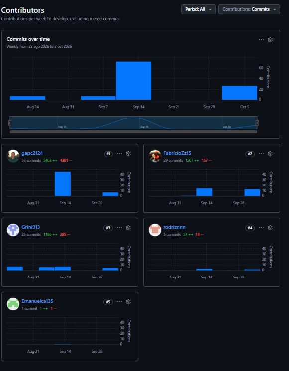
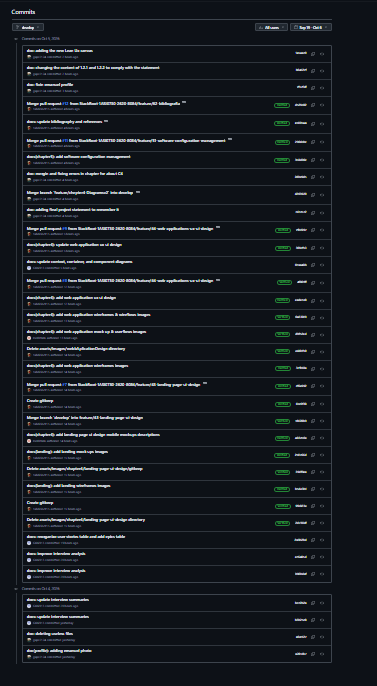

## Project Report Collaboration Insights

**URL del repositorio para el reporte del proyecto:** https://github.com/StackRoot-1ASI0730-2620-8084/Trazza-report

GitHub Collaboration Insights proporciona un cronograma que muestra las principales ramas y los procesos de fusión que han ocurrido. Todas las ramas se han generado siguiendo los principios de GitFlow, lo que garantiza una organización efectiva al utilizar un sistema de control de versiones.

* Emanuel Renato Checalla Apaza (Emanuelca135)
* Fabricio Jofred Lozano Quispe (FabricioZz15)
* Gabriel Augusto Peñaranda Caldas (gapc2024)
* Ingrid Melani Medina Merma (Grini913)
* Rodrigo Matias Vite Celis (rodriznnn)

Se dividieron las siguientes ramas para la colaboración en el proyecto:

* `main`
* `develop`
* `feature/11-startup-profile`
* `feature/12-solution-profile`
* `feature/13-segmentos-objetivo`
* `feature/21-competidores`
* `feature/22-entrevistas`
* `feature/23-needfinding`
* `feature/24-event-storming`
* `feature/25-ubiquitous-language`
* `feature/31-user-stories`
* `feature/32-impact-mapping`
* `feature/33-product-backlog`
* `feature/41-style-guidelines`
* `feature/42-information-architecture`
* `feature/43-landing-page-ui-design`
* `feature/44-web-applications-ux-ui-design`
* `feature/45-web-applications-prototyping`
* `feature/46-domain-driven-software-architecture`
* `feature/47-software-object-oriented-design`
* `feature/48-database-design`
* `feature/51-software-configuration-management`
* `feature/52-landing-page-services-applications-implementation`
* `feature/53-validation-interviews`
* `feature/54-video-about-the-product`
* `feature/61-conclusiones`
* `feature/62-bibliografia`
* `feature/63-anexos`
* `feature/chepter4-Diagramsv2`

### Entrega 1 - AV1
#### Versión 1.0 (06/09/2026) y Versión 1.1 (13/09/2026)

Durante la primera entrega, el equipo se centró en la elaboración y culminación del Capítulo 1 del informe. Las actividades se desarrollaron de manera colaborativa; nos dividimos las tareas de investigación y redacción de las secciones iniciales para garantizar la participación equitativa de todos los miembros. El trabajo se integró en el repositorio utilizando la estrategia Gitflow, realizando *commits* frecuentes y descriptivos en las ramas correspondientes antes de integrarlos a `develop`.

### Entregable TRABAJO PARCIAL (TB1)
#### Versiones 1.2 a 2.9 (15/09/2026 – 06/10/2026)

A continuación, explicamos y detallamos las analíticas de colaboración en base a lo obtenido de GitHub Insights para la entrega del Trabajo Parcial (TB1). Hemos colocado en el siguiente orden las imágenes correspondientes a: **Pulse**, **Contributors**, **Traffic** y **Network Graph**.

  <h4>1. Pulse</h4>
  
    

  <h4>2. Contributors</h4>
  
    

  <h4>3. Traffic</h4>
  
    

  <h4>4. Network Graph</h4>
  

### Entrega 3 - AV2 (Sprint 3)
#### Versiones 3.0 a 3.3 (10/11/2026 – 13/11/2026)

Durante la elaboración del avance AV2 correspondiente al Sprint 3, el equipo StackRoot consolidó la documentación técnica y de validación del proyecto en paralelo al despliegue de la nueva versión del Landing Page (`v1.2.0`), la segunda versión de la Frontend Web Application (`v2.0.0`) y la primera versión de los RESTful Web Services (`Trazza.Platform` `v1.0.0`). Las actividades en el repositorio `Trazza-report` se distribuyeron de forma coordinada entre los cinco integrantes:

* **Emanuel Renato Checalla Apaza (`Emanuelca135`):** Actualización de artefactos de diseño y documentación de los endpoints y flujos del Bounded Context *IAM & Fleet* (registro, autenticación JWT con rotación de refresh tokens, cifrado AES-GCM de documentos de identidad, verificación RENIEC y gestión de flota).
* **Fabricio Jofred Lozano Quispe (`FabricioZz15`):** Actualización de la sección 5.1 (*Software Configuration Management*) y documentación de los servicios y vistas del Bounded Context *Payment & Billing* (planes de monitoreo, suscripciones, liquidaciones de flete y compensaciones por lucro cesante), así como la actualización de la bibliografía en formato APA.
* **Ingrid Melani Medina Merma (`Grini913`):** Redacción del diseño de entrevistas de validación (sección 5.3.1), ejecución de la evaluación según heurísticas de usabilidad, diseño inclusivo y arquitectura de información (sección 5.3.3), y documentación del Bounded Context *Service Execution & Monitoring* (viajes, telemetría GPS, alertas de desvío e incidencias).
* **Gabriel Augusto Peñaranda Caldas (`gapc2024`):** Consolidación del Sprint Planning 3, Sprint Backlog 3, evidencias de desarrollo, ejecución, documentación OpenAPI/Scalar y despliegue en AWS (Amplify, EC2, RDS y CloudFront) en la sección 5.2.3, además de la actualización del *Student Outcome* y las conclusiones del informe.
* **Rodrigo Matias Vite Celis (`rodriznnn`):** Documentación del registro de entrevistas de validación (sección 5.3.2), redacción de las secciones *Video About-the-Product* (5.4) y *Video About-the-Team*, y documentación del Bounded Context *Loyalty & Reputation* (calificaciones mutuas y puntos de fidelidad).

  <h4>Contribuciones acumuladas en Trazza-report y Trazza-LandingPage</h4>
  
    
  

